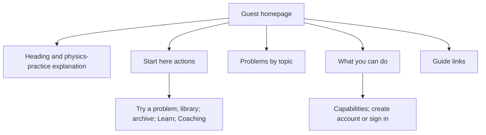
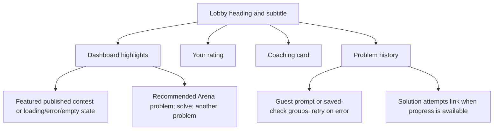
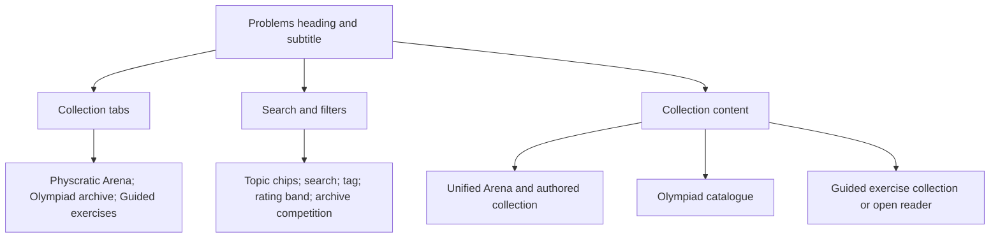
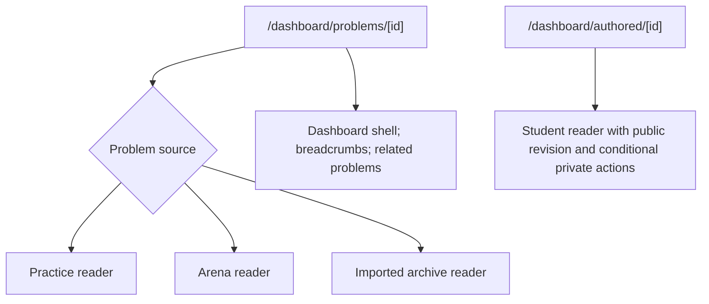
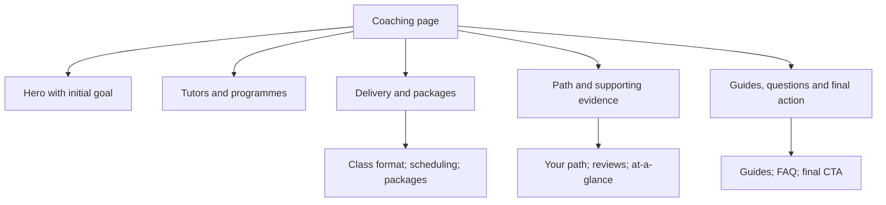
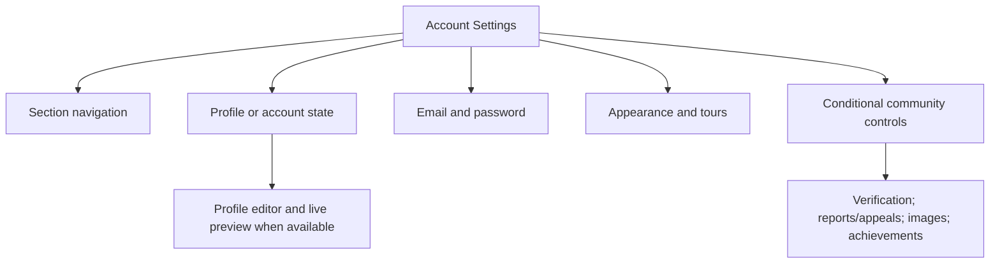

# Current page information hierarchies

Companion to [CURRENT_SITE_MAP.md](CURRENT_SITE_MAP.md).
Source snapshot: main `b3912ce60f80929c360ccb7956d6b394eef1aff5`. Inspected 11 November 2026.
These describe source composition and conditional content, not proposed improvements or observed live screenshots.
For the future /test/ design use TEST_PAGE_HIERARCHIES.md instead.

## Shared shells

| Shell | Existing structure |
| --- | --- |
| Dashboard | Guided tour, desktop sidebar/mobile sheet, top navigation, optional profile prompt, main content |
| Public library/Learn | Header/layout and server-rendered content, breadcrumbs where present |
| Coaching | Coaching-specific header/mobile navigation, content sections, footer and mobile CTA |
| Account/staff | Dedicated forms or page compositions; not uniformly dashboard pages |

Sources: components/kokonutui/layout.tsx, sidebar.tsx, top-nav.tsx; components/coaching/coaching-sections.tsx.
Order below follows JSX composition where inspected. Responsive positioning can differ.

## Public home: /

Source: components/home/landing.tsx. Signed-in / renders the Lobby instead.

## Lobby: /dashboard and member /

Sources: components/physics/overview.tsx, dashboard-highlights.tsx, rating-card.tsx, problem-history.tsx.
The recommendation card already calls pickProblem with browser solved-state input. Its presence must not be mistaken for the proposed topic/band recommendation system.
History groups are Solved correctly, Not yet solved and Not graded. Checks are explicitly described as not changing rating.

## Interactive library: /dashboard?view=problems

Source: components/physics/problem-library.tsx. Guided reader state hides tabs and filters. No course catalogue exists here.

## Public directories

| Route | Source content order |
| --- | --- |
| /problems | Breadcrumbs → title/description → interactive library link → topics → archive summary/link → practice links → Arena links |
| /problems/archive | Breadcrumbs → title/description → olympiad groups → years → problem links with topic |
| /problems/topics/[slug] | Breadcrumbs → topic heading/count → problem links → all-problems link |
| /learn | Introduction → guide cards with title, description, update date and reading duration |
| /learn/[slug] | Article identity/body → sources when present → related-practice section/library action → coaching text link |

Sources: matching app page files. Article body structure depends on the selected guide.

## Problem readers

Source: app/dashboard/problems/[id]/page.tsx and app/dashboard/authored/[id]/page.tsx.
This is reader dispatch and composition, not a claim that all readers share identical input/solution layouts.
Preserve complete statements, math/media, source identity, answer-mode distinctions and recovery contracts. Detailed inner-reader controls need a focused audit before redesign.

## Coaching: /coaching

Composition order: hero → tutors → programmes → class format → scheduling → packages → path → reviews → glance → guides → FAQ → final CTA. Footer/reveal/mobile CTA follow.
Sources: app/coaching/page.tsx and components/coaching/coaching-sections.tsx.
Reviews and achievements are content present in source, not independently verified claims in this audit.

### Consultation and tutor application

Both /coaching/consultation and /coaching/become-a-tutor use:
coaching header → back link → title → introduction → external form button → explanatory note → coaching footer.
The external form opens in a new tab. These are not native checkout, scheduling or form-confirmation pages.
Sources: components/coaching/coaching-form-page.tsx and coaching-form-link.tsx.

## Account, authoring, contests and staff

| Surface | Existing composition or confirmed responsibility | Conditions |
| --- | --- | --- |
| /dashboard/author | AuthoringWorkspace, or sign-in redirect/verification explanation | Signed-in verified author. Editor detail is not exhaustively mapped here |
| /dashboard/submissions | My solution attempts heading, ungraded/privacy explanation, SubmissionHistory | Signed-in |
| Contests query view | Workspace heading/subtitle and Contests component | Data and access-dependent |
| Rankings query view | Workspace heading/subtitle, contestant search, Rankings | Data-dependent |
| Guide query view | Workspace heading/subtitle and LearningGuide | Separate from public Learn articles |
| /dashboard/contests/[id] | Dashboard shell and ContestRoom | Valid ID; room/API access rules |
| /dashboard/contests/manage | Dashboard shell and ContestAdmin | Component/API permissions |
| /sign-in, /sign-up | AuthForm in corresponding mode, safe return destination | Existing sessions redirect |
| /forgot-password | ForgotPasswordForm with email readiness | Provider-dependent |
| /reset-password | ResetPasswordForm with token/link error | Valid token required for completion |
| /email-change | Outcome component with step/error/sign-in state | Query-derived presentation |
| /terms | Back link, title/version/date, provisional notice, section navigation, terms body, signup footer | Public page; terms not represented as legally final |
| /u/[handle] | Navigation, ProfileCard, optional reporting; absent/unavailable states | Public profile visibility and flags |
| /admin/verification | Navigation, review heading/description, dashboard or unavailable/access message | Gate and admin authorization |
| /admin/moderation | Navigation, review heading/description, dashboard or unavailable/access message | Gate and staff authorization |

Sources: corresponding page files listed in CURRENT_SITE_MAP.md. Deep editor, contest and staff component internals require a targeted follow-up audit before modifying them.

## Settings: /settings

Sources: app/settings/page.tsx and components/community/account-settings.tsx.
Appearance and tour controls exist separately from community profile availability. Profile area handles disabled, loading, error and signed-out states. Email/password requires a user; additional controls have their own gates.

## Verification limits

No screenshots or runtime were evaluated. No feature activation is inferred from code.
All 26 page routes are included in CURRENT_SITE_MAP.md; this companion groups related layouts to stay readable.
Use focused source/component inspection for exact control inventories before implementing replacement UI. These documents complement, not replace, existing tests and the fixed baseline checklist.
