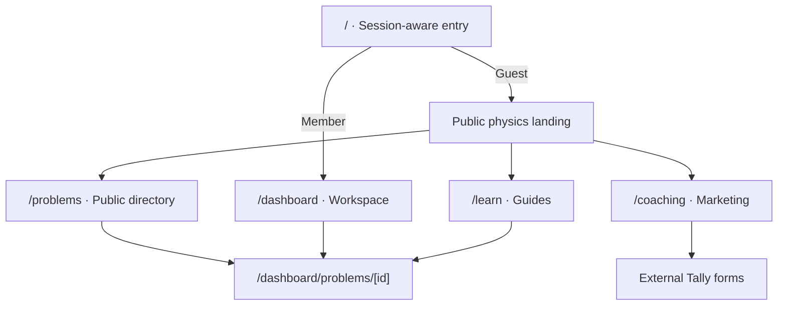

# Current website map

Source snapshot: main `b3912ce60f80929c360ccb7956d6b394eef1aff5`, inspected 11 November 2026.
This documents the existing application, not the experimental marketplace plan.
Companion: [CURRENT_PAGE_HIERARCHIES.md](CURRENT_PAGE_HIERARCHIES.md).
Future design: [TEST_SITE_MAP.md](TEST_SITE_MAP.md).

## Evidence boundary

All 26 app page files were read at the pinned main commit, with selected composition components inspected.
Descriptions are source-confirmed. No production browser, database, provider account or environment variables were inspected. Live deployment equivalence, enabled flags, inventory and end-to-end success remain unverified.
A route existing in code does not establish public accessibility or a working production feature. Component-level maps are structural summaries, not screenshot measurements.
The overhaul branch has new difficulty labels, prototype assets and planning docs beyond this snapshot. Main still uses Advanced (IPhO level) and Mastery. Do not mix those branch-only changes into current-main descriptions.
The current main equals our original overhaul baseline. Refresh this snapshot explicitly if main advances.

## Current structure

There is no implemented course marketplace homepage, course catalogue/detail route, instructor marketplace route or /test/ route in this snapshot. Instructor information currently appears within coaching content; community profiles are a different, gated feature.
This is a route/UI audit, not a claim that no commerce-related code could exist anywhere.

## Complete page route inventory

| Route | Current purpose | Access or state distinction | Source |
| --- | --- | --- | --- |
| `/` | Public landing or member Lobby | Session-dependent. Guest landing is public; member resolves to Overview | [app/page.tsx](https://github.com/Physcratic/physcratic/blob/b3912ce60f80929c360ccb7956d6b394eef1aff5/app/page.tsx) |
| `/dashboard` | Interactive workspace; overview by default | No page-level sign-in redirect. Private panels depend on sessions/APIs | [app/dashboard/page.tsx](https://github.com/Physcratic/physcratic/blob/b3912ce60f80929c360ccb7956d6b394eef1aff5/app/dashboard/page.tsx) |
| `/problems` | Public problem link directory | Practice, Arena, archive and topic links | [app/problems/page.tsx](https://github.com/Physcratic/physcratic/blob/b3912ce60f80929c360ccb7956d6b394eef1aff5/app/problems/page.tsx) |
| `/problems/archive` | Archive grouped by olympiad and year | Public source-backed directory | [app/problems/archive/page.tsx](https://github.com/Physcratic/physcratic/blob/b3912ce60f80929c360ccb7956d6b394eef1aff5/app/problems/archive/page.tsx) |
| `/problems/topics/[slug]` | Topic-specific problem links | Known non-empty topics; unknown slug gives 404 | [app/problems/topics/[slug]/page.tsx](https://github.com/Physcratic/physcratic/blob/b3912ce60f80929c360ccb7956d6b394eef1aff5/app/problems/topics/[slug]/page.tsx) |
| `/dashboard/problems/[id]` | Practice, Arena or imported archive reader | Known generated IDs; reader varies by source | [app/dashboard/problems/[id]/page.tsx](https://github.com/Physcratic/physcratic/blob/b3912ce60f80929c360ccb7956d6b394eef1aff5/app/dashboard/problems/[id]/page.tsx) |
| `/dashboard/authored/[id]` | Published authored-problem student reader | UUID validation; public publication boundary; private actions gated | [app/dashboard/authored/[id]/page.tsx](https://github.com/Physcratic/physcratic/blob/b3912ce60f80929c360ccb7956d6b394eef1aff5/app/dashboard/authored/[id]/page.tsx) |
| `/dashboard/author` | Problem Studio | Signed-in and verified email required at page entry | [app/dashboard/author/page.tsx](https://github.com/Physcratic/physcratic/blob/b3912ce60f80929c360ccb7956d6b394eef1aff5/app/dashboard/author/page.tsx) |
| `/dashboard/submissions` | My solution attempts | Sign-in required; private, described as ungraded | [app/dashboard/submissions/page.tsx](https://github.com/Physcratic/physcratic/blob/b3912ce60f80929c360ccb7956d6b394eef1aff5/app/dashboard/submissions/page.tsx) |
| `/dashboard/contests/[id]` | Contest room | ID validation; actual access depends on room/API rules | [app/dashboard/contests/[id]/page.tsx](https://github.com/Physcratic/physcratic/blob/b3912ce60f80929c360ccb7956d6b394eef1aff5/app/dashboard/contests/[id]/page.tsx) |
| `/dashboard/contests/manage` | Contest management | Admin component and API authorization; page presence is not permission | [app/dashboard/contests/manage/page.tsx](https://github.com/Physcratic/physcratic/blob/b3912ce60f80929c360ccb7956d6b394eef1aff5/app/dashboard/contests/manage/page.tsx) |
| `/coaching` | Coaching marketing and consultation discovery | Public; goal query passed to hero | [app/coaching/page.tsx](https://github.com/Physcratic/physcratic/blob/b3912ce60f80929c360ccb7956d6b394eef1aff5/app/coaching/page.tsx) |
| `/coaching/consultation` | Consultation introduction and external form link | Tally opens in a new tab; no on-page booking transaction shown | [app/coaching/consultation/page.tsx](https://github.com/Physcratic/physcratic/blob/b3912ce60f80929c360ccb7956d6b394eef1aff5/app/coaching/consultation/page.tsx) |
| `/coaching/become-a-tutor` | Tutor application introduction and external form link | Tally opens in a new tab | [app/coaching/become-a-tutor/page.tsx](https://github.com/Physcratic/physcratic/blob/b3912ce60f80929c360ccb7956d6b394eef1aff5/app/coaching/become-a-tutor/page.tsx) |
| `/learn` | Published guide directory | Public guide cards with dates and reading time | [app/learn/page.tsx](https://github.com/Physcratic/physcratic/blob/b3912ce60f80929c360ccb7956d6b394eef1aff5/app/learn/page.tsx) |
| `/learn/[slug]` | Published guide/article | Known published slugs only; related practice and coaching links | [app/learn/[slug]/page.tsx](https://github.com/Physcratic/physcratic/blob/b3912ce60f80929c360ccb7956d6b394eef1aff5/app/learn/[slug]/page.tsx) |
| `/sign-in` | Email/password sign-in | Existing session redirects to validated return destination | [app/sign-in/page.tsx](https://github.com/Physcratic/physcratic/blob/b3912ce60f80929c360ccb7956d6b394eef1aff5/app/sign-in/page.tsx) |
| `/sign-up` | Account creation | Existing session redirects; auth/provider requirements apply | [app/sign-up/page.tsx](https://github.com/Physcratic/physcratic/blob/b3912ce60f80929c360ccb7956d6b394eef1aff5/app/sign-up/page.tsx) |
| `/forgot-password` | Password reset request | Email transport readiness passed to form | [app/forgot-password/page.tsx](https://github.com/Physcratic/physcratic/blob/b3912ce60f80929c360ccb7956d6b394eef1aff5/app/forgot-password/page.tsx) |
| `/reset-password` | Set password from reset link | Token format and error state passed to form | [app/reset-password/page.tsx](https://github.com/Physcratic/physcratic/blob/b3912ce60f80929c360ccb7956d6b394eef1aff5/app/reset-password/page.tsx) |
| `/email-change` | Email-change outcome | Step/error query determines result | [app/email-change/page.tsx](https://github.com/Physcratic/physcratic/blob/b3912ce60f80929c360ccb7956d6b394eef1aff5/app/email-change/page.tsx) |
| `/settings` | Account, appearance and optional community settings | Guest/member states and per-feature gates | [app/settings/page.tsx](https://github.com/Physcratic/physcratic/blob/b3912ce60f80929c360ccb7956d6b394eef1aff5/app/settings/page.tsx) |
| `/terms` | Versioned terms and section navigation | Page explicitly calls terms provisional | [app/terms/page.tsx](https://github.com/Physcratic/physcratic/blob/b3912ce60f80929c360ccb7956d6b394eef1aff5/app/terms/page.tsx) |
| `/u/[handle]` | Community profile | Profile flag required or 404; visibility/public authorization applies | [app/u/[handle]/page.tsx](https://github.com/Physcratic/physcratic/blob/b3912ce60f80929c360ccb7956d6b394eef1aff5/app/u/[handle]/page.tsx) |
| `/admin/verification` | Medal-verification review | UI gate plus authorized admin queue response | [app/admin/verification/page.tsx](https://github.com/Physcratic/physcratic/blob/b3912ce60f80929c360ccb7956d6b394eef1aff5/app/admin/verification/page.tsx) |
| `/admin/moderation` | Moderation review | UI gate plus moderator/admin staff authorization | [app/admin/moderation/page.tsx](https://github.com/Physcratic/physcratic/blob/b3912ce60f80929c360ccb7956d6b394eef1aff5/app/admin/moderation/page.tsx) |

## Query-based screens and embedded views

These are real UI surfaces even though they do not add page files.

| URL/state | Screen |
| --- | --- |
| `/dashboard` or `?view=overview` | Lobby |
| `/dashboard?view=problems` | Interactive problem library |
| `/dashboard?view=contests` | Contest list |
| `/dashboard?view=rankings` | Rankings with contestant search |
| `/dashboard?view=guide` | Getting-started guide |
| `/dashboard?view=problems&topic=...` | Topic entry into library |
| `/dashboard?view=problems&search=1` | Search entry linked by top navigation and keyboard shortcut |
| Library collection state | Physcratic Arena, Olympiad archive, Guided exercises; authored collection supported in code |
| Guided exercise open | Library tabs/filters hidden while reading |
| `/coaching?goal=...` | Initial goal passed into coaching hero |
| `/settings?onboarding=1` | Optional profile-onboarding presentation |

Sources: [components/kokonutui/content.tsx](https://github.com/Physcratic/physcratic/blob/b3912ce60f80929c360ccb7956d6b394eef1aff5/components/kokonutui/content.tsx), [components/kokonutui/sidebar.tsx](https://github.com/Physcratic/physcratic/blob/b3912ce60f80929c360ccb7956d6b394eef1aff5/components/kokonutui/sidebar.tsx), [components/kokonutui/top-nav.tsx](https://github.com/Physcratic/physcratic/blob/b3912ce60f80929c360ccb7956d6b394eef1aff5/components/kokonutui/top-nav.tsx), [components/physics/problem-library.tsx](https://github.com/Physcratic/physcratic/blob/b3912ce60f80929c360ccb7956d6b394eef1aff5/components/physics/problem-library.tsx).
Query validation and exact serialization remain owned by existing route helpers, not this summary.

## Existing connections

| From | Actual destination/behaviour | Evidence |
| --- | --- | --- |
| Guest home | First practice problem, public library/archive/topic pages, Learn, Coaching, sign-up/in | HomeLanding |
| Public library | Interactive filtered library and canonical problem readers | /problems page |
| Dashboard chrome | Problem Studio, Lobby, Problems, Contests, Rankings, Coaching, topics and Settings | Sidebar |
| Top navigation | Search, Learn, Coaching, tour help, feedback and account controls; mobile placement differs | TopNav |
| Problem selection | Canonical practice/Arena/imported reader; authored problems have separate reader route | Dashboard page and reader dispatch |
| Learn article | Related problem links, public library and Coaching | Learn article page |
| Coaching | In-page sections, consultation path, tutor application and external Tally form actions | CoachingSections and CoachingFormLink |
| Restricted author/submission page | Sign-in with returnTo; unverified authors see verification guidance | Page route checks |
| Public community profile | Back to Arena; optional reporting control | Profile page |
| Staff moderation | Settings reports/appeals, Arena and verification review | Moderation page |

## Conditional features and preservation implications

| Surface | What source establishes | What is not established here |
| --- | --- | --- |
| Authored reading and submissions | Public published revision boundary; UUID checks; private submission actions | Production provider/schema health |
| Practice history | UI for saved checks and current-version statuses, guest prompt, retry/error handling | Saving activated in production or history populated |
| Profiles | Exact COMMUNITY_PROFILES_ENABLED=true gate; absent gate rejects before DB/session load | Current production flag value |
| Images, achievements, verification and moderation | Settings/profile/admin pass feature-gate results into optional controls | Installation, grants, active flags or staff readiness |
| Comments/statistics/reporting | Readers receive explicit gate outputs | Production activation or visibility |
| Contests | List, room and management components/routes exist | Published rounds, registration or admin privileges |
| Coaching forms | Outbound Tally link generation and source tracking exist | Successful form delivery or booking confirmation |
| Course marketplace | Proposed in business direction, absent from inspected page inventory | Availability of courses, checkout, enrolment or seller tools |

Sources: [lib/community/profile-route.ts](https://github.com/Physcratic/physcratic/blob/b3912ce60f80929c360ccb7956d6b394eef1aff5/lib/community/profile-route.ts), [app/settings/page.tsx](https://github.com/Physcratic/physcratic/blob/b3912ce60f80929c360ccb7956d6b394eef1aff5/app/settings/page.tsx), [app/dashboard/authored/[id]/page.tsx](https://github.com/Physcratic/physcratic/blob/b3912ce60f80929c360ccb7956d6b394eef1aff5/app/dashboard/authored/[id]/page.tsx), [components/physics/problem-history.tsx](https://github.com/Physcratic/physcratic/blob/b3912ce60f80929c360ccb7956d6b394eef1aff5/components/physics/problem-history.tsx), [components/coaching/coaching-form-link.tsx](https://github.com/Physcratic/physcratic/blob/b3912ce60f80929c360ccb7956d6b394eef1aff5/components/coaching/coaching-form-link.tsx).

## Maintenance

Keep current-state and future-state documents separate. Never rewrite this snapshot to make planned pages look implemented.
When updating current state, record the new main SHA and source evidence, re-enumerate page files, inspect affected components and say whether runtime was checked.
For redesign comparisons use UI_OVERHAUL_BASELINE.md as the fixed original reference. This current-state map does not authorize feature removals.
