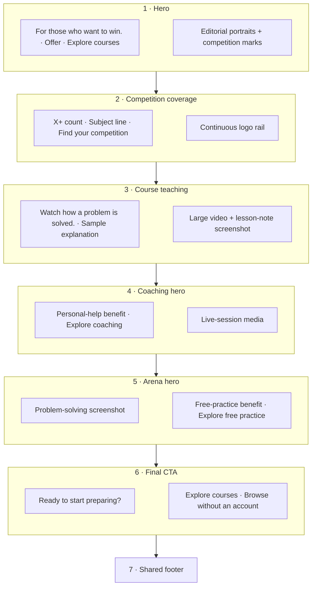

# Guest homepage: first structural iteration

Updated 11 November 2026. Branch: `codex/ui-overhaul`.
This is the quick-review document for the **whole guest landing page**. Settle the message, section order and actions here before refining individual assets, colours or animation.
Related: [TEST_SITE_MAP.md](TEST_SITE_MAP.md), [TEST_PAGE_HIERARCHIES.md](TEST_PAGE_HIERARCHIES.md).

## Sales reasoning before layout

Read [SALES_AND_MESSAGING_BRIEF.md](SALES_AND_MESSAGING_BRIEF.md) before revising composition or copy. Each section must advance the customer's decision with relevance, value, evidence, objection handling or an appropriate next action. Preserve the owner-approved arrangement while making the argument convincing. Do not start another visual pass before checking that argument.

## Page at a glance

| Order | Section and customer question | Rough desktop layout | Media space | Action |
| --- | --- | --- | --- | --- |
| 1 | Hero: Is this the preparation I want? | Motto and offer left, instructor imagery right | Three editorial portraits with paired competition marks | **Explore courses** |
| 2 | Competition coverage: Is my competition here? | Centred count/subject line, logo rail, lookup below | Continuous competition-logo placeholder rail | **Find your competition** |
| 3 | Course teaching: What will learning feel like? | Specific heading, large media composition, short explanation | Wide video excerpt with overlapping lesson-note screenshot | **Read a sample explanation**, plus media previews |
| 4 | Coaching hero: What if I need personal help? | Benefit-led copy and action left, session media right | Large live-session photograph/video slot | **Explore coaching** |
| 5 | Arena hero: Can I start practising now? | Product screenshot left, copy and action right | Large actual product-screenshot slot | **Explore free practice** |
| 6 | Final conversion: What should I do now? | One centred heading, short reassurance, dominant button | No competing illustration required | **Explore courses** |
| 7 | Footer: Where else can I go or get help? | Brand, Learn, Support, Physcratic groups, policy row | Minimal | Supporting links |

On narrow screens, put copy/action before media, retain substantial media space and keep each section readable in sequence.
Member homepage is unaffected: recent enrolled learning and selected-interest suggestions remain its lead.

## Rough page composition

This is a content wireframe, not pixel geometry. Each box describes visible space. Arrows between section groups show reading order, not navigation.

## Copy and CTA decisions

- Hero motto is exactly **For those who want to win.**
- Hero supporting text explains olympiad courses and the learning benefit. Portraits need competition marks, not biographies or long award lists.
- Main commercial action remains **Explore courses**, repeated at the top and bottom. It opens the in-prototype catalogue, not a signup wall.
- Competition lookup answers a concrete relevance question. It should not compete visually with the hero's main action.
- Coaching and Arena have distinct sections and destinations, not two small cards inside a generic section.
- Final heading: **Ready to start preparing?**
- Final support text: **Explore a course, check the level and see what you will learn.**
- Final reassurance: **Browse before creating an account.**
- Avoid equally prominent course/coaching/Arena buttons in the final CTA. Each alternative already has its own dedicated section.

## Removed from the guest landing

- Choose your olympiad subject gallery.
- Find a course for your next olympiad promotion.
- The old generic Other ways to prepare card pair, now replaced by the two dedicated product heroes.

Subject coverage still appears in the competition section. Subject/search filters still exist in the catalogue after Explore courses.
Do not remove the catalogue or member discovery functionality because its promotional sections were removed from the guest entry page.

## First-iteration review

Review only:
1. Can a visitor explain the offer and why it is relevant after the hero?
2. Is it easy to locate their competition?
3. Does the teaching section show the course experience?
4. Do Coaching and Arena have clear, distinct roles?
5. Is the final action obvious and consistent with the opening action?

Once these are settled, refine assets, spacing, type, responsive details and motion.
Keep a short record of the decision behind a section change rather than adding more competing design documents.

## Current implementation boundary

The standalone homepage implements this structural pass. Course/media/account data remain sample fixtures. Coaching/Arena actions open destination previews, not new implemented routes.
X+ is still a count placeholder. No testimonials, guarantees or unverified inventory are introduced.
JavaScript syntax and static section/order/action checks pass. Browser, mobile, accessibility and full application build/CI remain pending.
