# Experimental page information hierarchies

Living companion to [TEST_SITE_MAP.md](TEST_SITE_MAP.md). Branch: `codex/ui-overhaul`. Updated 11 November 2026.

## How to read these diagrams

The site map shows **where pages connect**. This document shows **what each page contains and what deserves attention first**.
Hierarchies remain proposed. The homepage now has an isolated sample-data prototype, with browser verification pending. Other pages remain unbuilt and untested. They are editable initial decisions, not fixed requirements or claims of available features.
Numbers represent intended reading/attention priority, not an exact viewport position or mandatory vertical stack. Use them to make rough wireframes, then test.
Each group owns its detail nodes. These are content relationships, not clickable navigation arrows.
On desktop, the main action may sit beside supporting content. On mobile, use a coherent reading and keyboard order. Do not hide essential suitability, price/access conditions, errors or safety information merely to shorten the page.
Exact section names here are planning labels, not final website copy.

## Shared shell

Keep brand and predictable navigation consistent. Offer Academy, Coaching and Arena destinations in a way that reflects actual availability.
Keep experimental/sample status visible without letting it dominate the page. Account controls depend on the approved local fixture/auth setup.
Retain accessible headings, skip navigation, focus and meaningful empty/error states. Prototype action labels must not imply a real payment, booking or message was completed.
Shared navigation is not redrawn on every page below. Footer/support links remain lower priority than the task.

## Shared footer information hierarchy

The homepage fixture now includes this footer in all three sample account states. It is secondary navigation, not another primary conversion area.

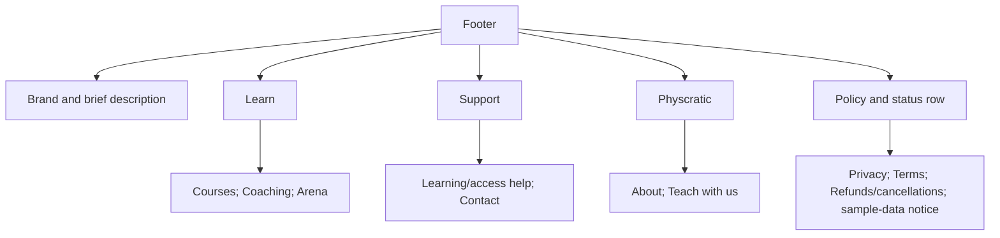

Courses returns to the existing prototype catalogue. Coaching and Arena open navigation previews.
Remaining links are explicitly proposed-destination or policy-status dialogs, not implemented pages. No fabricated contact details or policies.
On mobile the groups wrap into a compact grid with visible headings. This CSS exists but has not been browser-verified.
Keep purchase/access/refund conditions visible on the relevant offering or transaction too. The footer does not replace those disclosures.

### 1. Homepage: guest and member compositions

Route: `/test/`. Owner decision: guests need an introduction, while signed-in learners need recently studied enrolled courses and relevant discovery.
“Recently studied” excludes courses merely viewed while browsing.
There is no separate course-list route. Course detail URLs remain planned as `/test/courses/[slug]`.

#### Guest homepage

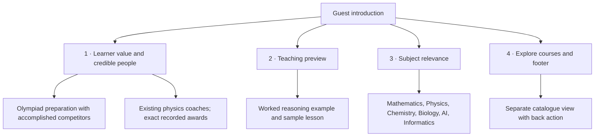

The landing view contains no course-card grid, search or filter controls. Explore courses opens those in a separate view within the same prototype, without introducing a new URL.
Hero coaching profiles use existing repository records and are labelled as coaching profiles. They do not imply those people authored the fictional course catalogue.
The teaching preview is illustrative and not attributed to those coaches.
Keep the main action focused on course discovery, with a secondary sample-lesson action. Do not use fabricated reviews, success rates or guarantees.

#### Member homepage

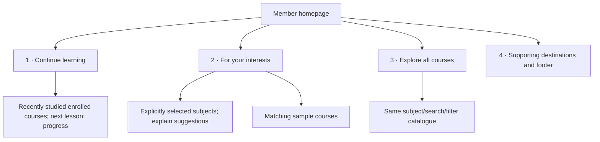

Two sample enrolled courses appear in recent-study order, each with a Continue lesson action.
Suggestions match chosen subjects and exclude sample enrolled courses. No inferred behaviour model or numerical recommendation score is used.
A member without enrolments sees no recent-course section. They can select subjects and explore suggestions/catalogue.
My learning and account controls replace guest account actions. One identity is proposed across Academy, Coaching and Arena, with separate access and records.

#### Prototype status

The standalone fixture implements these presentations and can open directly as guest or with `?view=member`. The View as toolbar still allows all three states.
App /test/ embeds the same file in local development only. Account state is simulated. There is no real auth, enrolment, progress write or course recommendation service.
Course, instructor and lesson details remain dialogs. Light/dark and responsive CSS exist, but browser validation is pending.
Search/filter state is kept when closing previews. Reload resets all fixture state.

### 2. Course details

Route: `/test/courses/[slug]`. Visitor decision: **Decide whether this course fits.**

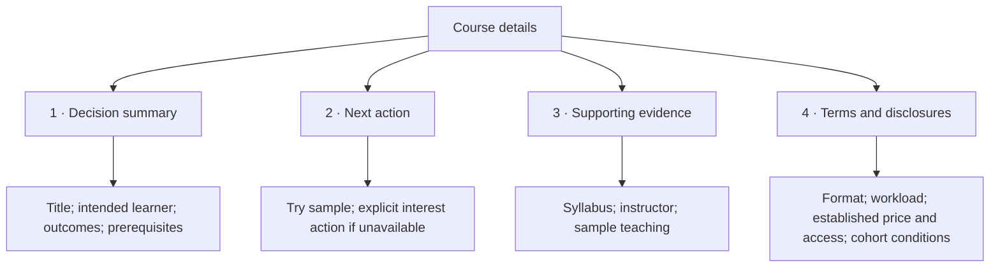

### 3. Instructor profile

Route: `/test/instructors/[slug]`. Visitor decision: **Assess teaching suitability and find an offering.**

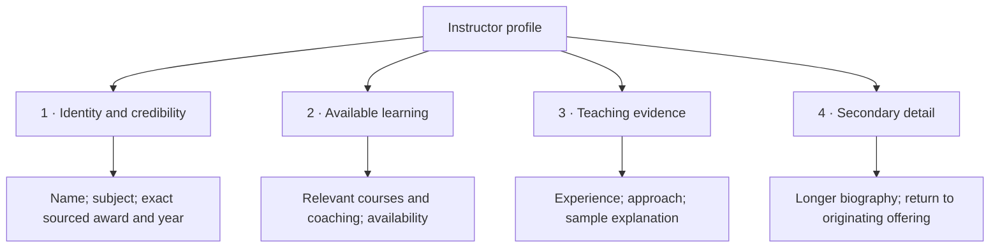

### 4. Coaching options

Route: `/test/coaching`. Visitor decision: **Choose a suitable live learning option.**

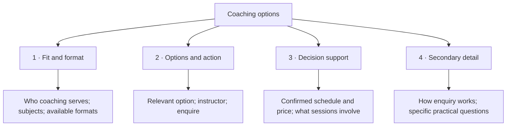

### 5. Coaching enquiry

Route: `/test/coaching/enquire`. Visitor decision: **Prepare an enquiry for the chosen option.**

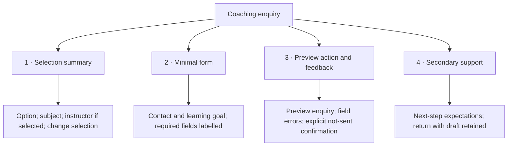

### 6. Practice discovery

Route: `/test/practice`. Visitor decision: **Find and open a suitable problem.**

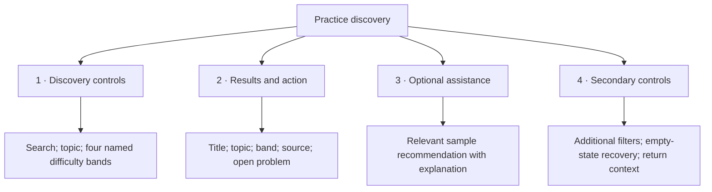

### 7. Problem reader

Route: `/test/practice/[id]`. Visitor decision: **Work on the problem and interpret feedback.**

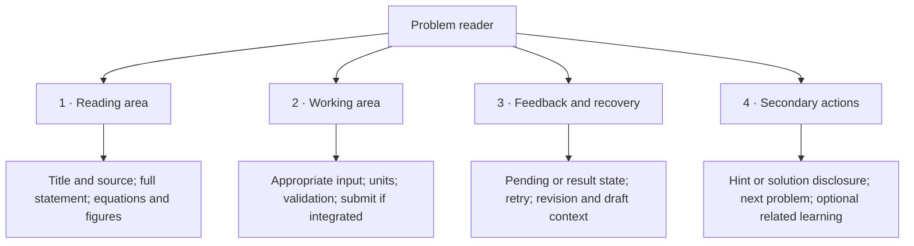

### 8. Guide catalogue

Route: `/test/learn`. Visitor decision: **Choose an explanation relevant to a need.**

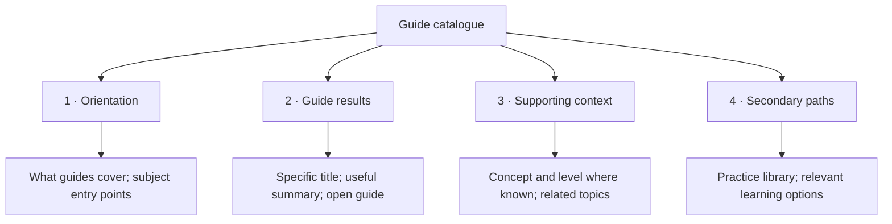

### 9. Guide reader

Route: `/test/learn/[slug]`. Visitor decision: **Understand a concept and apply it.**

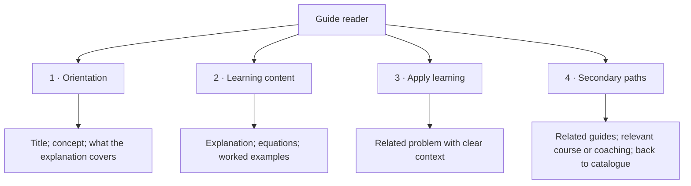

## States alongside the happy path

| Page type | States to design before considering it complete |
| --- | --- |
| Lists | Loading, no content yet, no filter matches, failure/retry, retained filters |
| Detail/profile | Missing ID, unavailable offering, missing optional evidence, direct entry and return |
| Enquiry | Incomplete fields, correction, preview confirmation, edit/back without draft loss; no real send |
| Problem | Sample vs integrated interaction, validation, pending, feedback, uncertainty/retry, stale revision, recovery |
| Guide | Missing content, long equations/media, related content unavailable |

## What stays unresolved

Guest introduction and member recent-learning priorities are confirmed. Hero copy, subject choices, course card density and how to represent limited actual inventory still need testing. Coaching remains secondary.
Additional catalogue filters should only appear when the inventory makes them useful.
Course purchase, student lesson delivery and creator workflows remain deferred.
Problem reader integration must obey existing answer and recovery contracts. These diagrams are not permission to rebuild grading or bypass feature gates.
Instructor sample data must be labelled consistently across profiles and offerings. Do not invent social proof.

## Update process

Before implementing a page, use its hierarchy to make a rough layout and compare it against the page specification and link contracts.
After trying the layout, update the hierarchy and record why the priority changed.
Keep this document focused on information priority. Put cross-page links in TEST_SITE_MAP.md and detailed behavioural contracts in their relevant engineering documents.
Preserve the original baseline checklist. Moving a feature into a disclosure is still a reachability and accessibility decision to verify.
