# Experimental page information hierarchies

## Decision rationale and learner correction

Read [PROTOTYPE_DESIGN_DECISIONS.md](PROTOTYPE_DESIGN_DECISIONS.md) for reasons, costs and owner corrections behind each prototype element. Record future changes there before implementing them. Decision L10 rejects the generic learner Other ways to prepare promotion: it is now hidden from the member homepage. Coaching/Arena remain in navigation and their dedicated guest heroes. No equivalent replacement promotion is added.

## Brand and navigation decision

Physcratic itself is the core course marketplace. Do not introduce Physcratic Courses or a parallel Academy brand in customer navigation. Coaching and Arena are extensions of the core product, sharing its account identity.
Guest navigation shows Coaching and Arena directly. Member navigation prioritizes My learning and Explore courses, with Coaching and Arena in a separate **More** disclosure beside account controls. Mobile navigation keeps the learning links first, followed by a More group for the extensions. More is separate from account settings. Brand/logo remains the homepage link; the footer retains Courses as a useful task link. Decision L11 records the reason and visibility tradeoff.
This changes prototype navigation only, not existing production routes or account implementation. The signed-out homepage concept is accepted as good enough for now; avoid further unsolicited visual redesign and focus subsequent work on requested details or other flows.

## Audience familiarity and labels

Owner direction: assume visitors have some existing familiarity with Physcratic and competition preparation. Do not explain every obvious category.
Default to no eyebrow above a heading. Keep one only when it adds information the heading, image, adjacent text and navigation do not already provide.
Remove repeated claims and generic organisational labels. The hero motto retains one offer explanation, but does not need a second medallist caption or selection-to-international-stage line.
Coaching and Arena are important product destinations. Introduce them as prominent section titles, with a concrete benefit and short explanation, not as tiny category labels.
Keep functional form labels, accessibility names, state/error feedback and necessary identification of sample media. These have a different purpose.
Use the removal test: if deleting a line loses no useful meaning or orientation, delete it.

Guidance:
- NN/g, Rewriting Digital Content for Brevity: https://www.nngroup.com/articles/rewriting-content-brevity/
- Australian Government Style Manual, Headings: https://www.stylemanual.gov.au/structuring-content/headings
- Joanna Wiebe for CXL, awareness and copy: https://cxl.com/conversion-rate-optimization/how-to-write-copy-that-sells-like-a-mofo-by-joanna-wiebe/

Application is contextual: the sources support concise, meaningful, audience-aware content, not a universal ban on labels.

## Established-company design direction (11 November 2026)

Owner explicitly authorized designing the future established company rather than limiting the concept to current inventory or team size.
The guest fixture now uses a dark-green editorial hero, warm high-contrast primary action, a broader competition-coverage presentation and a substantial lesson demonstration.
The course argument connects structured sequencing, explained methods and independent practice to learner benefits. Coaching is positioned around direct feedback and subject/level fit. Arena remains free physics practice, not a promise of practice support across every field.
The illustrative scale row is 50+ competition pathways, 200+ instructors/coaches and eight fields. The concept toolbar and row label clearly identify these as illustrative, not audited current business facts. No testimonials, student outcomes or performance guarantees are invented.
Owner-selected motto, approved section order, large media placeholders, competition lookup, catalogue and member experience remain.
The final CTA is "Your next round starts here." followed by Explore courses and browse-without-account reassurance.
Syntax/static checks pass. Browser, mobile/accessibility and application build/CI remain unverified.
Next: review the complete established-brand composition, then refine assets and actual offer details. Do not publish illustrative claims as verified facts.

Living companion to [TEST_SITE_MAP.md](TEST_SITE_MAP.md). Branch: `codex/ui-overhaul`. Updated 11 November 2026.

## How to read these diagrams

The site map shows **where pages connect**. This document shows **what each page contains and what deserves attention first**.
Hierarchies remain proposed. The homepage now has an isolated sample-data prototype, with browser verification pending. Other pages remain unbuilt and untested. They are editable initial decisions, not fixed requirements or claims of available features.
Numbers represent intended reading/attention priority, not an exact viewport position or mandatory vertical stack. Use them to make rough wireframes, then test.
Each group owns its detail nodes. These are content relationships, not clickable navigation arrows.
On desktop, the main action may sit beside supporting content. On mobile, use a coherent reading and keyboard order. Do not hide essential suitability, price/access conditions, errors or safety information merely to shorten the page.
Exact section names here are planning labels, not final website copy.

## Shared shell

Keep brand and predictable navigation consistent. Offer Academy, Coaching and Arena destinations in a way that reflects actual availability.
Keep experimental/sample status visible without letting it dominate the page. Account controls depend on the approved local fixture/auth setup.
Retain accessible headings, skip navigation, focus and meaningful empty/error states. Prototype action labels must not imply a real payment, booking or message was completed.
Shared navigation is not redrawn on every page below. Footer/support links remain lower priority than the task.

## Shared footer information hierarchy

The homepage fixture now includes this footer in all three sample account states. It is secondary navigation, not another primary conversion area.

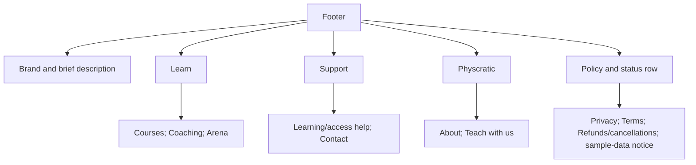

Courses returns to the existing prototype catalogue. Coaching and Arena open navigation previews.
Remaining links are explicitly proposed-destination or policy-status dialogs, not implemented pages. No fabricated contact details or policies.
On mobile the groups wrap into a compact grid with visible headings. This CSS exists but has not been browser-verified.
Keep purchase/access/refund conditions visible on the relevant offering or transaction too. The footer does not replace those disclosures.

### 1. Homepage: guest and member compositions

Route: `/test/`. Owner decision: guests need an introduction, while signed-in learners need recently studied enrolled courses and relevant discovery.
“Recently studied” excludes courses merely viewed while browsing.
There is no separate course-list route. Course detail URLs remain planned as `/test/courses/[slug]`.

#### Guest homepage

Read [GUEST_HOMEPAGE_LAYOUT.md](GUEST_HOMEPAGE_LAYOUT.md) for the full-page rough layout, copy, media allocation and CTA review.

| Order | Section | Primary content/action |
| --- | --- | --- |
| 1 | Hero | Exact motto, short offer, portraits/competition marks, Explore courses |
| 2 | Coverage | X+ placeholder, subject line, logo rail, Find your competition |
| 3 | Course teaching | Video, lesson-note screenshot, sample explanation |
| 4 | Coaching hero | Personal live support, session media, Explore coaching |
| 5 | Arena hero | Free physics practice, product screenshot, Explore free practice |
| 6 | Final CTA | Ready to start preparing? Explore courses, browse without account |
| 7 | Footer | Grouped support, learning, company and policy links |

Removed: Choose your olympiad subject gallery and Find a course for your next olympiad block. Catalogue filters and member discovery still exist.
The full-page diagram lives in GUEST_HOMEPAGE_LAYOUT.md to avoid duplicating it here.
Separate Coaching/Arena heroes replace the guest generic card pair. Settle the sales structure and actions before further visual detailing.
Actual destination pages and real services remain outside this fixture.

#### Guest visual system

The guest-only refinement uses a single rust accent for primary actions on light, peach on dark, consistent rectangular portrait frames and spacing-led grouping.
Remove duplicate section labels, decorative rotations, ornamental circles and unnecessary numbers. Keep substantial portrait, video, lesson-screenshot, coaching-session and Arena product-screenshot slots.
Use specific teaching/subject headings, balanced text widths, consistent arrows and useful pressed/dialog feedback with reduced-motion support.
Hero motto stays exact. No simulated loading is added to immediate actions.
Calculated primary CTA text contrast: 6.31:1 light, 8.64:1 dark. Full browser and accessibility review remains pending.

#### Competition coverage section

Position: directly below the hero. Title: **Preparation across X+ competitions.** X+ remains a count placeholder.
Subtitle: Mathematics / Physics / Chemistry / Biology / AI / Informatics / Debate / Chess.
The logo rail communicates breadth; the explicit search lets visitors find a competition without waiting for a logo to pass.

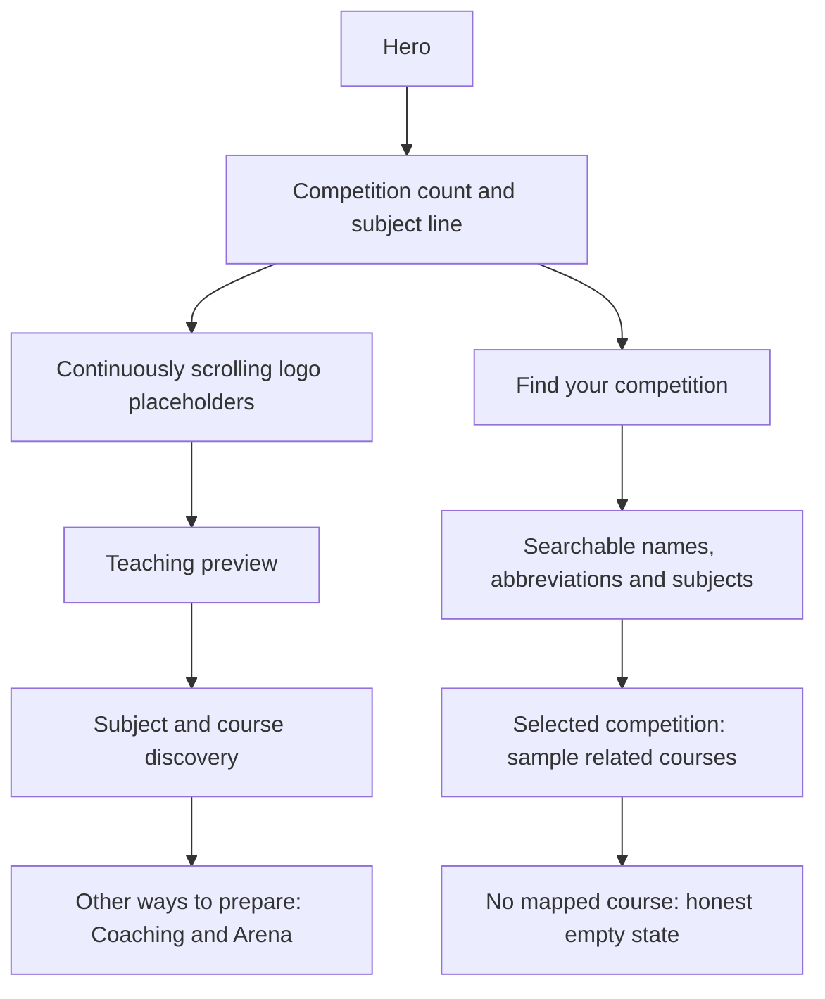

Example directory entries and course mappings are explicitly sample data. Debate and Chess have no course examples yet. Logos do not imply sponsorship or endorsement.
Search includes a useful no-match state and clear-search action. Catalogue clear/subject actions remove the competition context.
Pause controls and a reduced-motion static rail remain. Coaching/Arena now appear after the course sections rather than being hidden for guests.

#### Member homepage

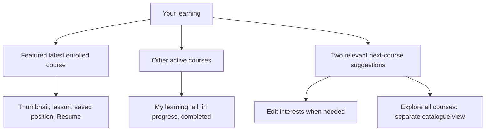

The hero action resumes the actual selected fixture course. The second active enrolment is a compact visual card. Completed courses appear in My learning, not the active homepage list.
Recommendations exclude sample enrolments and default to Mathematics/Physics; other chosen interests get an accurate matching-subject reason.
Remove the redundant Your learning eyebrow and explanatory greeting. Keep one useful page heading.
No-enrolment members see discovery without an empty resume section.
Sample 08:24 video and Example 2 reading positions illustrate future recovery. They are not persisted or sought in a real player.
My learning is now a complete in-page view with status filters, matching resume/review actions and back navigation. No /test/learning route exists.
Catalogue controls appear only on the catalogue view. Guest landing remains unchanged.

#### Prototype status

The standalone fixture implements these presentations and can open directly as guest or with `?view=member`. The View as toolbar still allows all three states.
App /test/ embeds the same file in local development only. Account state is simulated. There is no real auth, enrolment, progress write or course recommendation service.
Course, instructor and lesson details remain dialogs. Light/dark and responsive CSS exist, but browser validation is pending.
Search/filter state is kept when closing previews. Reload resets all fixture state.

### 2. Course details

Route: `/test/courses/[slug]`. Visitor decision: **Decide whether this course fits.**

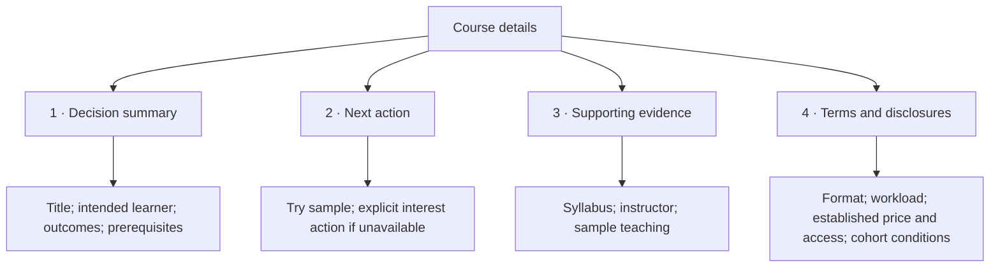

### 3. Instructor profile

Route: `/test/instructors/[slug]`. Visitor decision: **Assess teaching suitability and find an offering.**

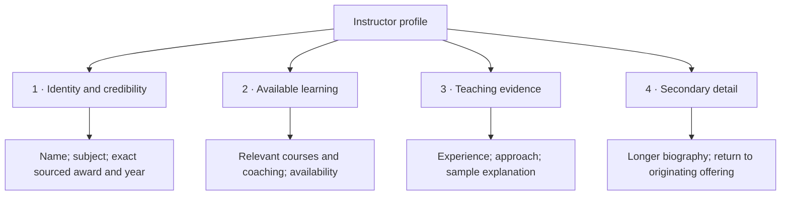

### 4. Coaching options

Route: `/test/coaching`. Visitor decision: **Choose a suitable live learning option.**

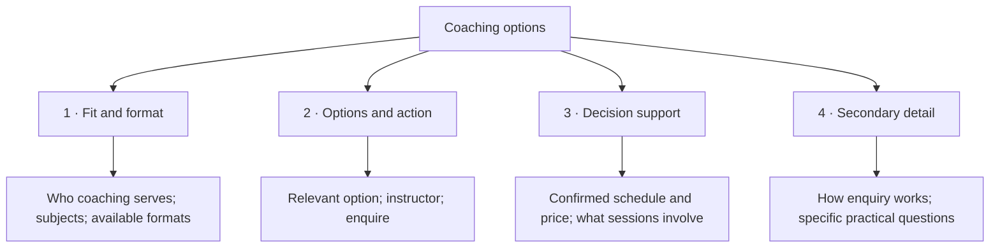

### 5. Coaching enquiry

Route: `/test/coaching/enquire`. Visitor decision: **Prepare an enquiry for the chosen option.**

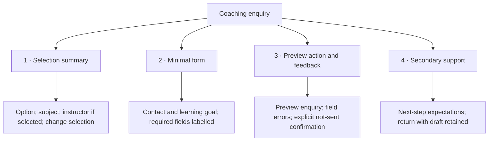

### 6. Practice discovery

Route: `/test/practice`. Visitor decision: **Find and open a suitable problem.**

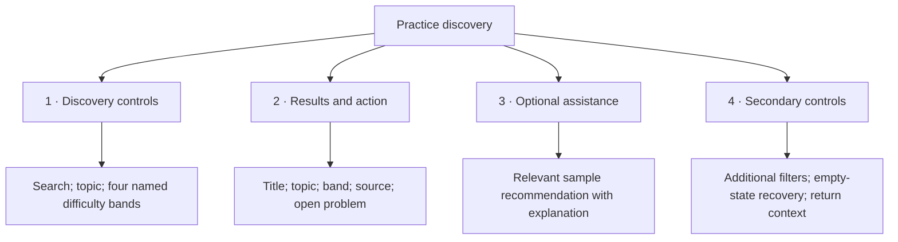

### 7. Problem reader

Route: `/test/practice/[id]`. Visitor decision: **Work on the problem and interpret feedback.**

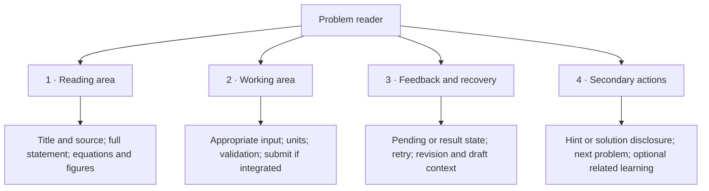

### 8. Guide catalogue

Route: `/test/learn`. Visitor decision: **Choose an explanation relevant to a need.**

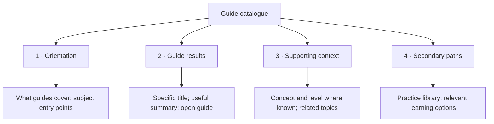

### 9. Guide reader

Route: `/test/learn/[slug]`. Visitor decision: **Understand a concept and apply it.**

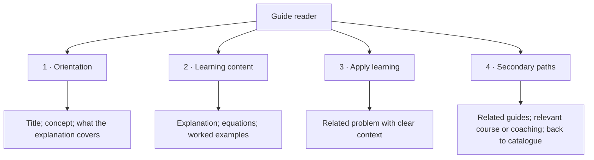

## States alongside the happy path

| Page type | States to design before considering it complete |
| --- | --- |
| Lists | Loading, no content yet, no filter matches, failure/retry, retained filters |
| Detail/profile | Missing ID, unavailable offering, missing optional evidence, direct entry and return |
| Enquiry | Incomplete fields, correction, preview confirmation, edit/back without draft loss; no real send |
| Problem | Sample vs integrated interaction, validation, pending, feedback, uncertainty/retry, stale revision, recovery |
| Guide | Missing content, long equations/media, related content unavailable |

## What stays unresolved

Guest introduction and member recent-learning priorities are confirmed. Hero copy, subject choices, course card density and how to represent limited actual inventory still need testing. Coaching remains secondary.
Additional catalogue filters should only appear when the inventory makes them useful.
Course purchase, student lesson delivery and creator workflows remain deferred.
Problem reader integration must obey existing answer and recovery contracts. These diagrams are not permission to rebuild grading or bypass feature gates.
Instructor sample data must be labelled consistently across profiles and offerings. Do not invent social proof.

## Update process

Before implementing a page, use its hierarchy to make a rough layout and compare it against the page specification and link contracts.
After trying the layout, update the hierarchy and record why the priority changed.
Keep this document focused on information priority. Put cross-page links in TEST_SITE_MAP.md and detailed behavioural contracts in their relevant engineering documents.
Preserve the original baseline checklist. Moving a feature into a disclosure is still a reachability and accessibility decision to verify.
