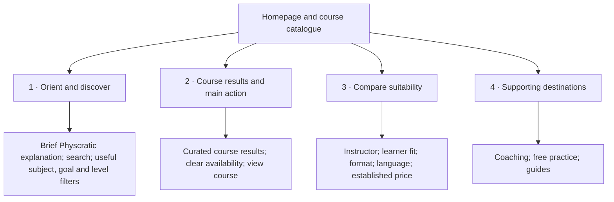
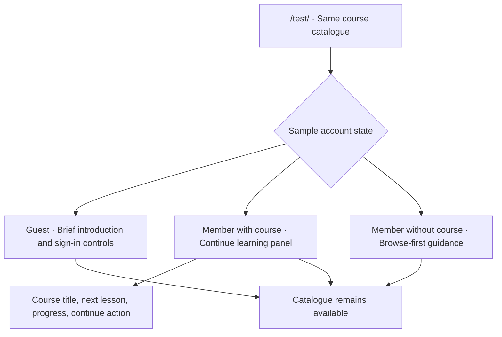
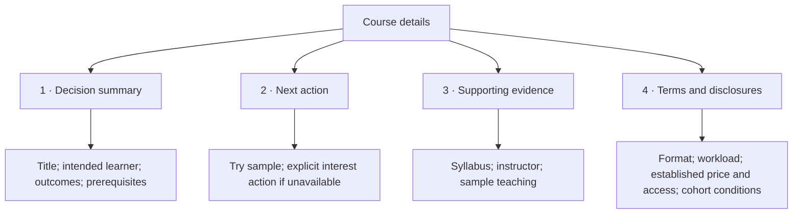
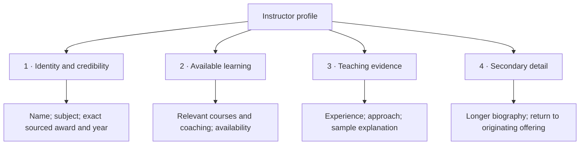
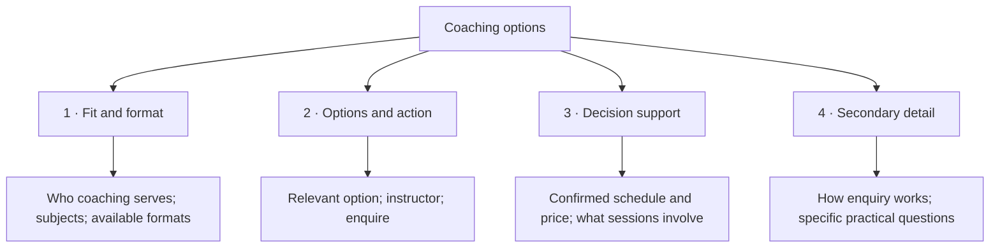
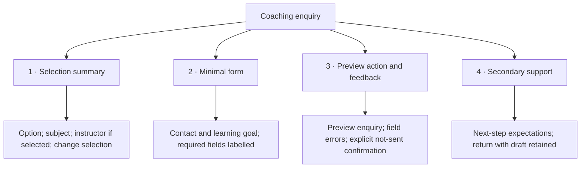
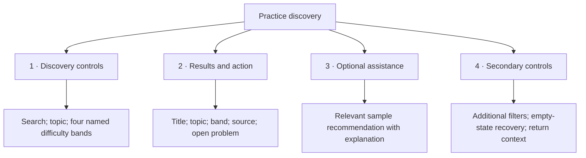
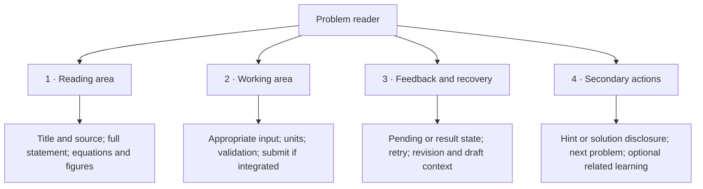
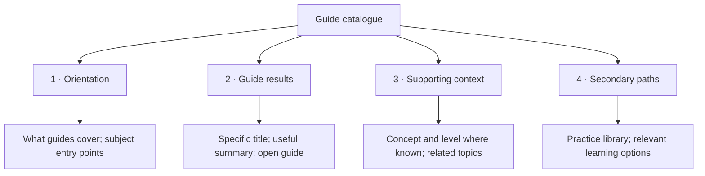
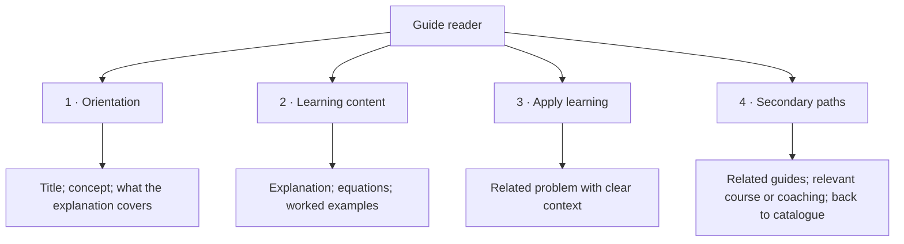

# Experimental page information hierarchies

Living companion to [TEST_SITE_MAP.md](TEST_SITE_MAP.md). Branch: `codex/ui-overhaul`. Updated 11 November 2026.

## How to read these diagrams

The site map shows **where pages connect**. This document shows **what each page contains and what deserves attention first**.
Hierarchies remain proposed. The homepage now has an isolated sample-data prototype, with browser verification pending. Other pages remain unbuilt and untested. They are editable initial decisions, not fixed requirements or claims of available features.
Numbers represent intended reading/attention priority, not an exact viewport position or mandatory vertical stack. Use them to make rough wireframes, then test.
Each group owns its detail nodes. These are content relationships, not clickable navigation arrows.
On desktop, the main action may sit beside supporting content. On mobile, use a coherent reading and keyboard order. Do not hide essential suitability, price/access conditions, errors or safety information merely to shorten the page.
Exact section names here are planning labels, not final website copy.

## Shared shell

Keep brand and predictable navigation consistent. Offer Academy, Coaching and Arena destinations in a way that reflects actual availability.
Keep experimental/sample status visible without letting it dominate the page. Account controls depend on the approved local fixture/auth setup.
Retain accessible headings, skip navigation, focus and meaningful empty/error states. Prototype action labels must not imply a real payment, booking or message was completed.
Shared navigation is not redrawn on every page below. Footer/support links remain lower priority than the task.

### 1. Homepage and course catalogue

Route: `/test/`. Visitor decision: **Find a course that fits my goal and level.**
Owner decision: course discovery is the homepage's primary purpose. There is no separate catalogue page. Course detail routes remain `/test/courses/[slug]`.
Keep the brand explanation brief. Do not make visitors pass through a marketing landing page to reach the catalogue. Course availability remains explicit, including samples or planned offerings.

Search and filters update results on `/test/`. Returning from a course restores search, filters and scroll position.
Show useful no-match or no-available-course states without inventing inventory. Additional filters appear only when useful.

### Homepage variations by account state

One account is the proposed identity across Academy, Coaching and Arena. Course access is separate from account existence.
The current fixture provides three states, sample dialogs and a light/dark toggle. It does not authenticate or persist anything.
Keep the Continue learning area compact so the homepage remains the catalogue.
Account controls change with state, not the site's primary purpose.
The separate sample toolbar is a research control, not a planned customer-facing account switcher.

### 2. Course details

Route: `/test/courses/[slug]`. Visitor decision: **Decide whether this course fits.**

### 3. Instructor profile

Route: `/test/instructors/[slug]`. Visitor decision: **Assess teaching suitability and find an offering.**

### 4. Coaching options

Route: `/test/coaching`. Visitor decision: **Choose a suitable live learning option.**

### 5. Coaching enquiry

Route: `/test/coaching/enquire`. Visitor decision: **Prepare an enquiry for the chosen option.**

### 6. Practice discovery

Route: `/test/practice`. Visitor decision: **Find and open a suitable problem.**

### 7. Problem reader

Route: `/test/practice/[id]`. Visitor decision: **Work on the problem and interpret feedback.**

### 8. Guide catalogue

Route: `/test/learn`. Visitor decision: **Choose an explanation relevant to a need.**

### 9. Guide reader

Route: `/test/learn/[slug]`. Visitor decision: **Understand a concept and apply it.**

## States alongside the happy path

| Page type | States to design before considering it complete |
| --- | --- |
| Lists | Loading, no content yet, no filter matches, failure/retry, retained filters |
| Detail/profile | Missing ID, unavailable offering, missing optional evidence, direct entry and return |
| Enquiry | Incomplete fields, correction, preview confirmation, edit/back without draft loss; no real send |
| Problem | Sample vs integrated interaction, validation, pending, feedback, uncertainty/retry, stale revision, recovery |
| Guide | Missing content, long equations/media, related content unavailable |

## What stays unresolved

Homepage course discovery is confirmed. Its exact content order and how to represent limited current course inventory still need testing. Coaching remains a secondary destination.
Additional catalogue filters should only appear when the inventory makes them useful.
Course purchase, student lesson delivery and creator workflows remain deferred.
Problem reader integration must obey existing answer and recovery contracts. These diagrams are not permission to rebuild grading or bypass feature gates.
Instructor sample data must be labelled consistently across profiles and offerings. Do not invent social proof.

## Update process

Before implementing a page, use its hierarchy to make a rough layout and compare it against the page specification and link contracts.
After trying the layout, update the hierarchy and record why the priority changed.
Keep this document focused on information priority. Put cross-page links in TEST_SITE_MAP.md and detailed behavioural contracts in their relevant engineering documents.
Preserve the original baseline checklist. Moving a feature into a disclosure is still a reachability and accessibility decision to verify.
