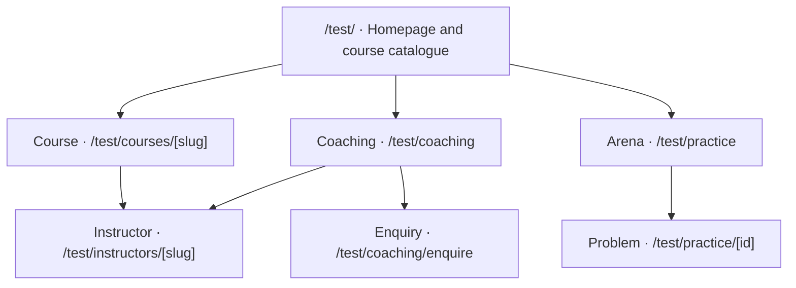
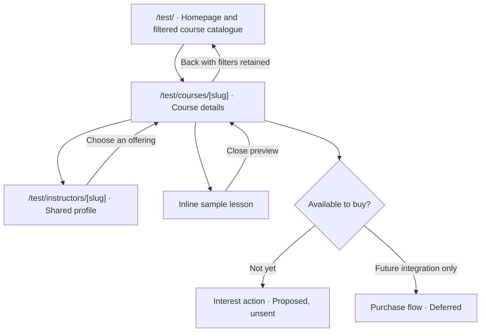
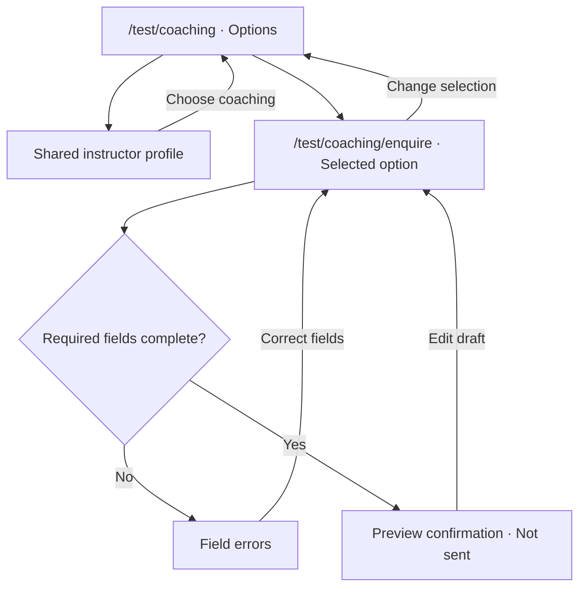
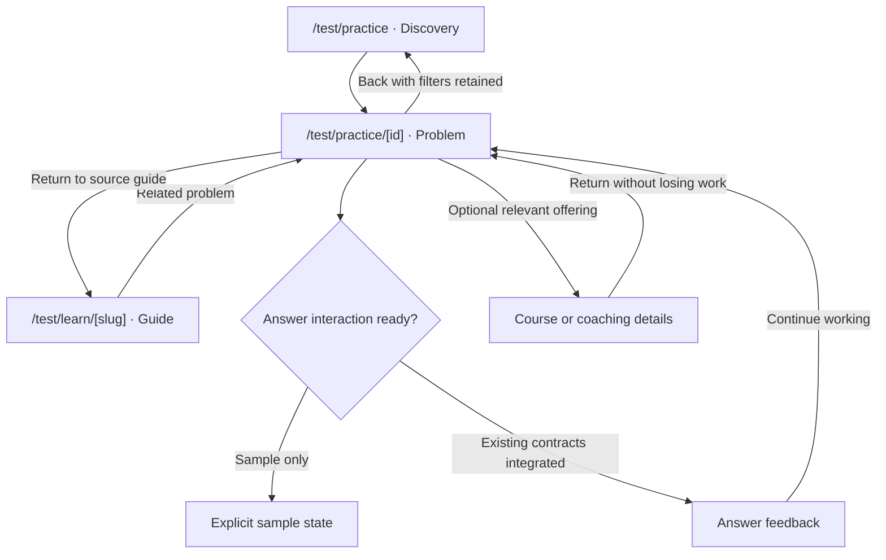

# Physcratic experimental site map

## Decision rationale and learner correction

Read [PROTOTYPE_DESIGN_DECISIONS.md](PROTOTYPE_DESIGN_DECISIONS.md) for reasons, costs and owner corrections behind each prototype element. Record future changes there before implementing them. Decision L10 rejects the generic learner Other ways to prepare promotion: it is now hidden from the member homepage. Coaching/Arena remain in navigation and their dedicated guest heroes. No equivalent replacement promotion is added.

## Enrolled learner homepage revision

The enrolled member homepage is now a study starting point rather than a catalogue-first page.

| Priority | Content | Behaviour |
| --- | --- | --- |
| 1 | Featured latest enrolled course | Thumbnail, specific next lesson, sample saved position 08:24 and dominant Resume action |
| 2 | Other active enrolled courses | Compact visual cards with progress and correct lesson resume |
| 3 | Related discovery | Two eligible suggestions matching selected interests; sample enrolments excluded; reason per card |
| 4 | Broader browsing | Explore all courses opens catalogue as a separate in-page view |

My learning is a full-page prototype view, not a modal, with All courses, In progress and Completed filters. Three sample enrolments include two active and one completed course. Only active courses appear on the homepage.
Default member interests match Mathematics/Physics. Edit interests opens optional controls rather than displaying all preferences permanently.
Saved video/reading positions are illustrative fixtures. Resume opens the corresponding lesson preview and explains its position; no real media seek, progress write, enrolment or auth implementation is claimed.
The no-enrolment state has interest-based discovery and no fabricated recent learning. Catalogue filters, clear/reset and competition lookup are preserved. The guest landing is visually unchanged.
My learning and catalogue are in-page views, not new application routes. Logo/back returns to the homepage.
JS syntax/static checks pass. Browser, keyboard/mobile/accessibility and full application checks remain pending.

## Brand and navigation decision

Physcratic itself is the core course marketplace. Do not introduce Physcratic Courses or a parallel Academy brand in customer navigation. Coaching and Arena are extensions of the core product, sharing its account identity.
Guest navigation shows Coaching and Arena directly. Member navigation prioritizes My learning and Explore courses, with Coaching and Arena in a separate **More** disclosure beside account controls. Mobile navigation keeps the learning links first, followed by a More group for the extensions. More is separate from account settings. Brand/logo remains the homepage link; the footer retains Courses as a useful task link. Decision L11 records the reason and visibility tradeoff.
This changes prototype navigation only, not existing production routes or account implementation. The signed-out homepage concept is accepted as good enough for now; avoid further unsolicited visual redesign and focus subsequent work on requested details or other flows.

## Audience familiarity and labels

Owner direction: assume visitors have some existing familiarity with Physcratic and competition preparation. Do not explain every obvious category.
Default to no eyebrow above a heading. Keep one only when it adds information the heading, image, adjacent text and navigation do not already provide.
Remove repeated claims and generic organisational labels. The hero motto retains one offer explanation, but does not need a second medallist caption or selection-to-international-stage line.
Coaching and Arena are important product destinations. Introduce them as prominent section titles, with a concrete benefit and short explanation, not as tiny category labels.
Keep functional form labels, accessibility names, state/error feedback and necessary identification of sample media. These have a different purpose.
Use the removal test: if deleting a line loses no useful meaning or orientation, delete it.

Guidance:
- NN/g, Rewriting Digital Content for Brevity: https://www.nngroup.com/articles/rewriting-content-brevity/
- Australian Government Style Manual, Headings: https://www.stylemanual.gov.au/structuring-content/headings
- Joanna Wiebe for CXL, awareness and copy: https://cxl.com/conversion-rate-optimization/how-to-write-copy-that-sells-like-a-mofo-by-joanna-wiebe/

Application is contextual: the sources support concise, meaningful, audience-aware content, not a universal ban on labels.

## Established-company design direction (11 November 2026)

Owner explicitly authorized designing the future established company rather than limiting the concept to current inventory or team size.
The guest fixture now uses a dark-green editorial hero, warm high-contrast primary action, a broader competition-coverage presentation and a substantial lesson demonstration.
The course argument connects structured sequencing, explained methods and independent practice to learner benefits. Coaching is positioned around direct feedback and subject/level fit. Arena remains free physics practice, not a promise of practice support across every field.
The illustrative scale row is 50+ competition pathways, 200+ instructors/coaches and eight fields. The concept toolbar and row label clearly identify these as illustrative, not audited current business facts. No testimonials, student outcomes or performance guarantees are invented.
Owner-selected motto, approved section order, large media placeholders, competition lookup, catalogue and member experience remain.
The final CTA is "Your next round starts here." followed by Explore courses and browse-without-account reassurance.
Syntax/static checks pass. Browser, mobile/accessibility and application build/CI remain unverified.
Next: review the complete established-brand composition, then refine assets and actual offer details. Do not publish illustrative claims as verified facts.

Living design document for `codex/ui-overhaul`. Updated 11 November 2026.
This is the starting point for deciding what belongs on each `/test/` page. Edit it as decisions change.

## Guest page structure: review first

Use [GUEST_HOMEPAGE_LAYOUT.md](GUEST_HOMEPAGE_LAYOUT.md) to review the complete guest page, section roles, rough composition and CTA copy before visual detailing. Current order: hero → competition coverage → teaching preview → Coaching hero → Arena hero → final course CTA → footer. The subject gallery and redundant course-promotion section are removed. Member presentation remains unchanged.

## Current-site references

For what exists today, use [CURRENT_SITE_MAP.md](CURRENT_SITE_MAP.md) and [CURRENT_PAGE_HIERARCHIES.md](CURRENT_PAGE_HIERARCHIES.md). They are pinned source snapshots, distinct from this experimental plan. Live availability is not inferred from source presence.

## Product brief

Physcratic is an education marketplace where students learn from accomplished competitors across academic olympiads and, eventually, areas such as debate, MUN and chess.
Academy is the long-term course business. Coaching is the initial commercial offering and bootstrapping channel. Arena supplies useful free practice, acquisition, retention and brand credibility.
The homepage at `/test/` has two audience-specific compositions. Guests see a sales-focused introduction with instructor evidence, a teaching preview and compact subject relevance. Explore courses opens catalogue browsing as a separate in-prototype view, rather than displaying cards and filters immediately. Members see recently studied enrolled courses and interest-based suggestions before catalogue browsing. Coaching and free practice remain supporting destinations. There is no separate `/test/courses/` catalogue page. Course detail URLs remain `/test/courses/[slug]`.
Start with a curated offering and expand toward a marketplace. Do not imply that future subjects, courses, payments or instructor tools are available today.

Authority: the owner's current conversation decisions, supported by the supplied October 2026 business proposal, especially sections 6–9, 12, 15–16, 46 and 54–56. The private proposal is not copied into this public repository. Its examples, financial figures and recommendations are not verified marketing claims or automatic implementation requirements.
The latest explicit owner decision takes precedence over proposal recommendations.

## Decision principle

Help this visitor make their next meaningful decision, with enough evidence to make it confidently.

Before adding content, identify the visitor, their task, their next decision, the evidence they need and what belongs on another page.
A section must help someone understand, choose, act or recover. Keep decorative filler out.
Use short realistic content in prototypes. Do not fabricate verified awards, reviews, enrolments, prices or availability.
Any invented instructor or offering must be clearly marked as sample throughout its connected pages.

## Status and scope

- **Confirmed direction:** parallel experimental site at `/test/`, course-catalogue homepage without a separate catalogue route, iterative prototyping, existing site preserved.
- **Proposed:** route names below, section order, primary actions and page contents. They are editable first drafts.
- **Deferred:** production checkout, enrolment, lesson delivery, creator publishing and broader categories until their requirements are separately settled.
- **Implementation:** `/test/` now embeds a standalone course-homepage fixture in local development only. It simulates guest, enrolled-member and member-without-enrolments states. No real auth, course access or cross-platform account integration exists. Other experimental routes remain unbuilt. The earlier practice prototype remains a separate exploration.
- Keep the experiment local-only initially. A future implementation must enforce a development boundary and exclude experimental routes from public navigation, indexing and sitemaps. Noindex alone is not access control. No deployment is authorized.

## Route hierarchy

This diagram shows proposed hierarchy, not every cross-page link. The table below specifies connections.

Instructor pages are shared records, not copies owned by Academy or Coaching.
The experimental paths need not match existing application URLs.

## Focused navigation diagrams

These are proposed interactions, not implemented routes. The overview above gives hierarchy. These diagrams show decisions, shared destinations and return paths. Keep each diagram focused as the site grows.

### Course discovery

A direct course URL must work without a catalogue visit. Preserve course context on instructor links. Interest collection, checkout and access delivery are not implemented or authorized by this diagram.

### Coaching enquiry

Retain the selected coaching option, subject and optional instructor. The prototype confirmation must say no enquiry was sent. Real submission, delivery, retention and booking need a separately verified integration.

### Practice and related learning

Paid learning links are secondary. Only link an offering that exists and matches the topic. Preserve problem identity, revision and recovery when real answering is integrated. These diagrams do not establish that integration.

### Maintenance

When changing a route or action, update its page specification, link contract and affected diagram together. Keep state details such as submission retries in a dedicated diagram when implemented, rather than expanding this overview indefinitely.

## Page information hierarchies

See [TEST_PAGE_HIERARCHIES.md](TEST_PAGE_HIERARCHIES.md) for a proposed content-priority diagram for every page below. These diagrams describe each page internally, while this map describes routes and cross-page connections. Update both when changing a page's purpose or contents.

## Page specifications

The homepage has a **sample-data implementation with browser verification pending**. Other routes below remain planned, not built. Course and instructor previews are dialogs, not implemented detail routes. Contents and priorities remain subject to review.

| Page | Visitor's decision | Initial contents | Primary action | Connections and context |
| --- | --- | --- | --- | --- |
| `/test/` | Guest: understand Physcratic's value and explore. Member: resume enrolled learning or find a relevant course | Guest motto, portrait/competition-mark hero and teaching media preview; member recent enrolled courses and chosen-interest suggestions; shared multi-subject catalogue, filters and footer | Guest: Explore courses. Member: Continue lesson, or discover if no enrolments | Recently studied means enrolled and studied, not recently viewed. Detail previews remain dialogs. No separate catalogue route |
| `/test/courses/[slug]` | Is this course suitable? | Intended outcomes, target learner, prerequisites, syllabus, instructor, sample lesson, delivery format, workload, price/access terms and availability when established | Try a sample, or register interest if not available | Shared instructor ID, preview lesson ID. Keep course vs scheduled cohort distinct. No fake purchase |
| `/test/instructors/[slug]` | Do I trust this person to teach me? | Exact sourced competition achievements, role, teaching approach/experience, sample teaching and their offerings | View a relevant offering | Shared instructor ID to course IDs and coaching options. Never infer teaching quality from awards alone |
| `/test/coaching` | Does live coaching fit my needs? | Existing formats and subjects, instructors, fit, how enquiry works, scheduling/pricing details only when confirmed | Enquire about coaching | Instructor/subject/offering context passed to enquiry. Current public coaching data must be inspected before reuse |
| `/test/coaching/enquire` | How do I ask about an appropriate class? | Selected offering summary, minimal contact/goal fields, next-step expectations, errors and confirmation | Preview enquiry | Draft state only initially. Show “not sent” explicitly. No real submission or booking until integrated and verified |
| `/test/practice` | Which problem should I attempt? | Topic and four-band discovery, browsing/search, source/availability, optional sample recommendation | Open a problem | Stable problem identity, source kind, filters and return location |
| `/test/practice/[id]` | How do I solve this and understand my result? | Readable statement, equations/figures, appropriate answer interaction, feedback and solution access, clear return/next action | Work on the problem | Preserve revision/answer/recovery contracts when integrated. Relevant coaching/course link is secondary |
| `/test/learn` | Which free explanation helps me? | Existing guide topics with useful summaries and links | Open a guide | Guide slug, subject context |
| `/test/learn/[slug]` | Do I understand this concept and what can I try? | Guide content, worked examples, relevant practice and optional related offering | Try related practice | Stable guide/problem/offering IDs |

Account, progress, contests, rankings, authoring, community, moderation and settings still exist in the original product. They are **unmapped for experimental redesign**, not approved removals. Consult UI_OVERHAUL_BASELINE.md before bringing them into this map.
Future student learning/dashboard and instructor creator routes are deferred. Do not silently create a complete LMS or seller dashboard from this map.

## Cross-page link contracts

| From | Action | Destination | Data carried | Return behaviour |
| --- | --- | --- | --- | --- |
| Homepage catalogue | Choose a subject or goal | Filtered results on `/test/` | Subject/competition ID and search/filter state | Stay on homepage and retain selections |
| Homepage catalogue | View course | `/test/courses/[slug]` | Course slug and catalogue return state | Back returns to `/test/` with filters, search and scroll restored |
| Homepage | Explore coaching | `/test/coaching` | Optional subject/competition context | Home returns to `/test/` |
| Course detail | Meet instructor | Instructor profile | Instructor ID and originating course | Back to that course |
| Instructor | Explore their course | Course detail | Course slug | Instructor remains reachable |
| Coaching | Enquire | Enquiry | Coaching option ID, optional instructor/subject | Back preserves selection |
| Course detail | Sample lesson | Proposed inline preview first | Course and lesson IDs | Close returns to course |
| Free guide | Try a related problem | Problem reader | Problem identity, guide return path | Return to guide |
| Problem reader | Explore related learning | Relevant course/coaching page | Subject and optional source problem | Easy return without losing work |

Do not show a related offering unless it exists in the shared data and is relevant. Do not interrupt solving with purchase prompts.
Missing IDs must produce an understandable unavailable state and a way back, not a broken link.

## Guest visual landing page

Owner-selected hero motto: **For those who want to win.** Preserve the exact wording and punctuation. This explicit owner copy decision overrides the general no-slogan rule for this headline only.
Supporting copy explains olympiad courses taught by accomplished competitors.
Hero imagery is a large editorial composition of three instructor portrait slots paired with competition-logo slots. Do not put names, exact award lists or subject biographies in the hero. Detailed credentials belong on relevant profiles/offerings, with accessible identification supplied when actual assets are selected.
The slots are intentional image placeholders, not generated or unverified photographs. Competition marks will represent instructor credentials, not organisational endorsement.
Immediately below: a large 16:9 teaching-video placeholder with an overlapping annotated-lesson screenshot slot. Both open media-preview dialogs. There is no actual video and no fake playback.
The former subject artwork gallery is removed from the guest landing. Subject browsing remains available in the catalogue and competition-coverage section.
Finish with a repeated Explore courses action and shared footer.
The guest landing contains no catalogue grid or filter form on entry. Explore courses opens the separate in-file catalogue view with a return action. No new course-list URL.
Member recent-learning, selected interests, course fixtures and account simulation remain unchanged.
Asset dimensions, intended content and accessibility notes: `prototypes/marketplace-home/ASSET_BRIEF.md`.

## Guest design refinement

Applied the owner's supplied design checklist to the guest presentation: remove redundant labels, use spacing to group content, reserve accent colour for primary actions, make secondary headings specific, keep arrow treatments consistent, remove decorative frames/rotations and tighten text contrast.
The exact hero motto remains **For those who want to win.**
Hero portraits use consistent rectangular frames, spacing and paired competition-logo slots. Names and detailed achievements stay outside the hero. Large media and subject artwork areas remain.
Teaching heading is now "Watch how a problem is solved." Subject heading is "Choose your olympiad subject."
Guest-only accent: rust on light, peach on dark. Calculated CTA text contrast is 6.31:1 and 8.64:1 respectively. These calculations are not whole-page browser qualification.
Spacing, inner radii, wrap widths, minimum control sizes, dialog feedback and reduced-motion handling are aligned. No synthetic loading delay is added because fixture actions are immediate.
Member styling and behaviour are outside this guest-only refinement.

## Competition coverage and discovery

The guest section directly below the hero now reads **Preparation across X+ competitions.** X+ is an explicit count placeholder, not a computed or verified business claim.
A compact subject line covers Mathematics, Physics, Chemistry, Biology, AI, Informatics, Debate and Chess.
The looping rail belongs inside this coverage section. It shows labelled logo placeholders for the sample directory, not a supported-by or sponsor claim.
Find your competition opens a searchable example list. Search matches full names, abbreviations and subjects. Selecting an entry opens the catalogue view with its explicit sample course-ID mapping.
Examples: IMO, IPhO, IChO, IBO, IOAI, IOI, a generic debate competition and a generic chess tournament. Debate/chess have no sample course mappings and honestly show an empty result.
Mapped courses are illustrative related content, not confirmed preparation or real availability for those competitions.
Changing subject or clearing filters clears competition-specific mapping. The selection/context is retained while viewing a course dialog.
Rail pause/hover/focus and reduced-motion behaviour remain. Member learning presentation is unchanged apart from the shared catalogue supporting this filter context.
After the course teaching preview, show separate full-width Coaching and Arena heroes, each with a large media slot and distinct action. Finish with one course-discovery CTA and the footer. Their destinations remain explanatory previews.
Current guest order: hero → competition coverage/rail/search → teaching preview → Coaching hero → Arena hero → final course CTA → footer.
Verification: JavaScript syntax and static mapping/reset/count/section checks pass. Browser and complete app verification remain pending.

## Shared footer experiment

Implemented in the homepage fixture, with contents still subject to review.

| Group | Items | Current behaviour |
| --- | --- | --- |
| Brand | Physcratic and short product description | Returns to homepage content |
| Learn | Courses, Coaching, Arena | Courses returns to catalogue; other sections open existing navigation previews |
| Support | Learning and access help, Contact | Explicit proposed-destination dialogs |
| Physcratic | About Physcratic, Teach with us | Explicit proposed-destination dialogs |
| Policy row | Privacy, Terms, Refunds and cancellations | Policy-status previews, not published policies or new routes |

No contact information, service commitment, instructor onboarding or policy has been invented. The Terms preview acknowledges the current application's provisional /terms separately.
Support/company/policy pages are proposed only and not added as implemented routes. Material purchase conditions must also be shown at the purchase decision, not hidden exclusively in footer links.
Footer action priority is lower than course discovery. Use labelled groups and keep the same footer across sample account states.
Do not add a newsletter, social feed, unsupported links or full sitemap without a user need.
Verification: footer destination/handler checks and JavaScript syntax pass. Browser/mobile/keyboard/contrast verification still pending.

## Homepage account-state experiment

Owner accepted one Physcratic account across Academy, Coaching and Arena. Identity can be shared while course entitlements, coaching records, Arena activity and instructor/staff permissions remain distinct.
This is a product decision, not implemented real account integration.

| State at /test/ | First content | Account controls | Catalogue |
| --- | --- | --- | --- |
| Guest | Exact motto, editorial portrait/logo slots, immersive media preview and subject artwork | Sign in and create account | Opens through Explore courses, not visible on initial landing |
| Enrolled member | Recently studied enrolled courses, followed by selected-interest suggestions | My learning and sample account menu | Additional browsing below personal learning |
| Member without enrolments | No-enrolment guidance and selectable interests, no recent-course panel | Same member controls | Suggestions and multi-subject browsing |

An Arena account must not be assigned a course automatically or redirected away from course discovery on the main homepage.
Implementation: `prototypes/marketplace-home/index.html`, embedded by `app/test/page.tsx` only in local development, plus a directly openable standalone file.
Simulated sign-in changes fixture state only. Course/instructor/lesson previews are dialogs. Coaching/Arena are explanatory navigation stubs.
Search, subject chips, level/format filters, clear/no-match recovery, selectable interests, theme toggle and responsive CSS exist. The fixture covers Mathematics, Physics, Chemistry, Biology, AI and Informatics, with the broader scope being fields with international olympiads. Arena remains a physics-practice preview, not a promise of practice across all subjects. No real sign-in, enrolment, payment, persistence or lesson completion exists.
Verification: JavaScript syntax and static fixture/isolation checks pass. Browser connection refused, so runtime, responsive/accessibility, Next build and application CI remain unverified.
See `prototypes/marketplace-home/README.md` for review steps.

## Shared sample data

Current homepage fixtures live in the standalone prototype script. When integrating native application pages, extract a shared typed fixture module such as `components/experimental/fixtures.ts` instead of duplicating these records.
Use a single source for subjects, competition goals, instructors, courses and coaching options.
Stable IDs connect records: course.instructorIds, coaching.instructorIds, course.subjectId and related problem identities.
Represent availability explicitly, such as sample, planned or available. Avoid interpreting absent information as a confirmed offering.
Derive instructor offerings from IDs rather than manually duplicating listings.
Never load production credentials, real enquiries or private learner data to make a prototype look complete.

## Staged to-do list

### 1. Information and shell

- [ ] Confirm initial audience, available offerings and truthful instructor information.
- [ ] Try two homepage content hierarchies before polishing either.
- [ ] Select shared navigation, type, spacing and component direction.
- [x] Add a development-only `/test/` fixture wrapper and three sample account states. Browser/build verification pending.
- [x] Add internally consistent homepage sample courses/instructors and no-match recovery. Cross-route integration remains pending.

### 2. One complete commercial discovery flow

- [ ] Homepage → offering → instructor → enquiry or sample lesson.
- [ ] Make prototype-only actions explicit and keep enquiries unsent.
- [ ] Check direct URLs, back navigation, shared data and mobile/keyboard access.
- [ ] Observe likely users finding an appropriate offering without a tutorial.
- [ ] Record findings and revise the page specifications.

### 3. Free value and connections

- [ ] Add Arena discovery and one reader flow.
- [ ] Add relevant Learn connections.
- [ ] Keep paid suggestions contextual and secondary during practice.
- [ ] Reconcile affected capabilities with the original baseline checklist.

### 4. Integration after design selection

- [ ] Inventory real data/API and feature-gate requirements.
- [ ] Replace samples incrementally with approved real functionality.
- [ ] Verify guest/member, loading/error/recovery and accessibility paths.
- [ ] Complete required application checks before review-ready delivery.
- [ ] Decide separately what may replace existing routes. No automatic launch.

## Assumptions to test

| Question | Current hypothesis | Evidence |
| --- | --- | --- |
| Should discovery start with subject or competition goal? | Goal-oriented entry may make choices more relevant | Untested |
| What leads the homepage? | Guest introduction and member recent enrolled learning are the owner's decision. Member suggestions use selected interests | Confirmed direction. Two sample homepage states implemented, not user-tested |
| Do instructor credentials need a dedicated page? | Shared profiles help users assess suitability | Untested |
| Is guided selection better than immediate browsing? | Depends on catalogue size and visitor experience | Earlier A/B practice sketch exists, no user results |

## Keep this map useful

Before a page change, read its row, its incoming/outgoing links and shared data requirements.
Afterward update contents, route status, link contracts, unresolved decisions and the staged checklist in the same checkpoint.
Record owner decisions distinctly from assumptions. Do not mark a route built or a flow verified just because code exists.
The handoff contains only the current checkpoint and next task, and links here for product structure.
Use the fixed original baseline for preservation, not as a requirement to retain the old appearance.
