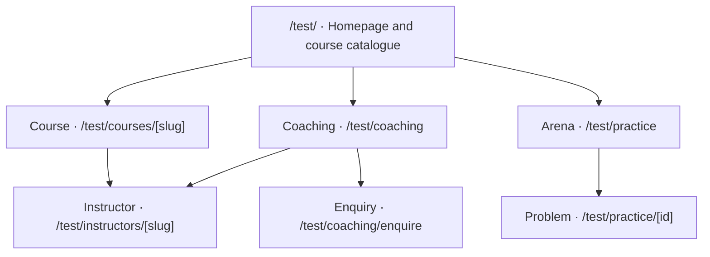
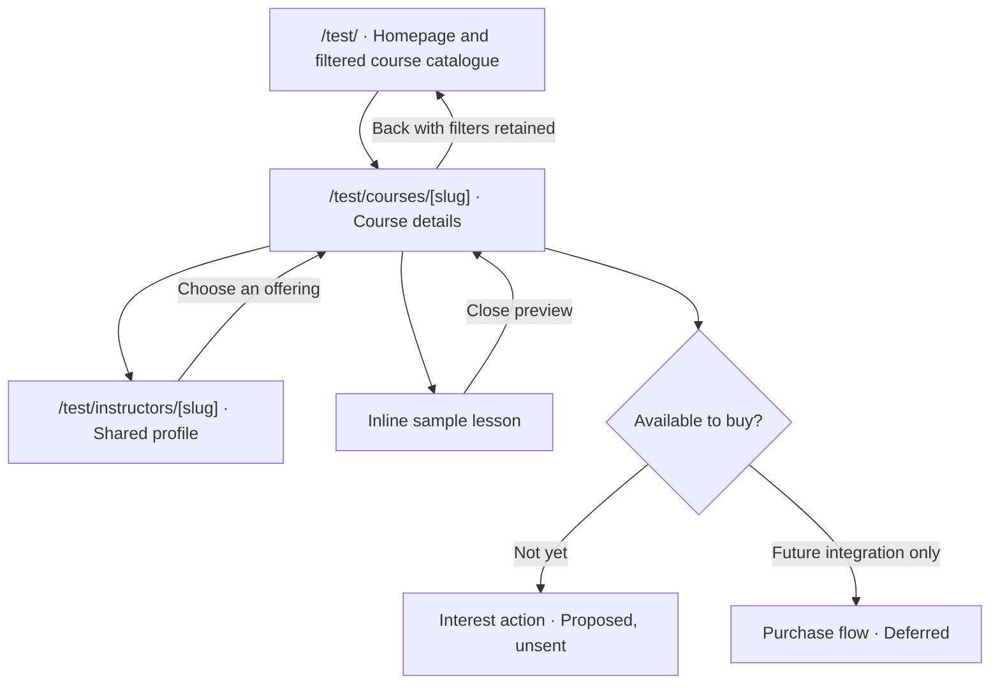
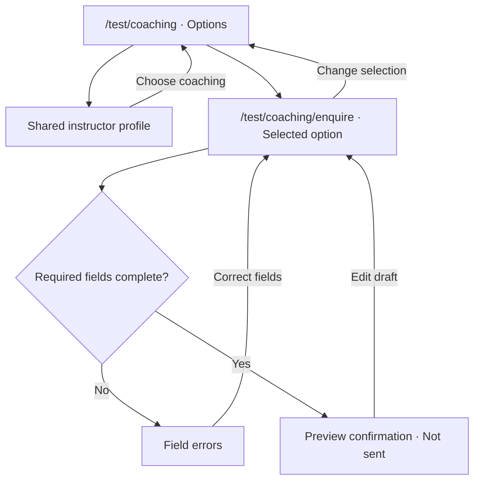
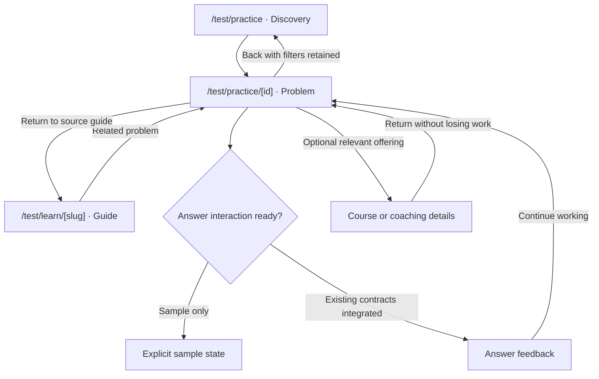

# Physcratic experimental site map

Living design document for `codex/ui-overhaul`. Updated 11 November 2026.
This is the starting point for deciding what belongs on each `/test/` page. Edit it as decisions change.

## Current-site references

For what exists today, use [CURRENT_SITE_MAP.md](CURRENT_SITE_MAP.md) and [CURRENT_PAGE_HIERARCHIES.md](CURRENT_PAGE_HIERARCHIES.md). They are pinned source snapshots, distinct from this experimental plan. Live availability is not inferred from source presence.

## Product brief

Physcratic is an education marketplace where students learn from accomplished competitors across academic olympiads and, eventually, areas such as debate, MUN and chess.
Academy is the long-term course business. Coaching is the initial commercial offering and bootstrapping channel. Arena supplies useful free practice, acquisition, retention and brand credibility.
The homepage at `/test/` is the primary course catalogue for Physcratic. It represents the whole brand through course discovery, with coaching and free practice as supporting destinations. There is no separate `/test/courses/` catalogue page. Course detail URLs remain `/test/courses/[slug]`.
Start with a curated offering and expand toward a marketplace. Do not imply that future subjects, courses, payments or instructor tools are available today.

Authority: the owner's current conversation decisions, supported by the supplied October 2026 business proposal, especially sections 6–9, 12, 15–16, 46 and 54–56. The private proposal is not copied into this public repository. Its examples, financial figures and recommendations are not verified marketing claims or automatic implementation requirements.
The latest explicit owner decision takes precedence over proposal recommendations.

## Decision principle

Help this visitor make their next meaningful decision, with enough evidence to make it confidently.

Before adding content, identify the visitor, their task, their next decision, the evidence they need and what belongs on another page.
A section must help someone understand, choose, act or recover. Keep decorative filler out.
Use short realistic content in prototypes. Do not fabricate verified awards, reviews, enrolments, prices or availability.
Any invented instructor or offering must be clearly marked as sample throughout its connected pages.

## Status and scope

- **Confirmed direction:** parallel experimental site at `/test/`, course-catalogue homepage without a separate catalogue route, iterative prototyping, existing site preserved.
- **Proposed:** route names below, section order, primary actions and page contents. They are editable first drafts.
- **Deferred:** production checkout, enrolment, lesson delivery, creator publishing and broader categories until their requirements are separately settled.
- **Implementation:** no `/test/` routes exist as part of this planning checkpoint. The earlier standalone practice prototype is an exploration, not the marketplace shell.
- Keep the experiment local-only initially. A future implementation must enforce a development boundary and exclude experimental routes from public navigation, indexing and sitemaps. Noindex alone is not access control. No deployment is authorized.

## Route hierarchy

This diagram shows proposed hierarchy, not every cross-page link. The table below specifies connections.

Instructor pages are shared records, not copies owned by Academy or Coaching.
The experimental paths need not match existing application URLs.

## Focused navigation diagrams

These are proposed interactions, not implemented routes. The overview above gives hierarchy. These diagrams show decisions, shared destinations and return paths. Keep each diagram focused as the site grows.

### Course discovery

A direct course URL must work without a catalogue visit. Preserve course context on instructor links. Interest collection, checkout and access delivery are not implemented or authorized by this diagram.

### Coaching enquiry

Retain the selected coaching option, subject and optional instructor. The prototype confirmation must say no enquiry was sent. Real submission, delivery, retention and booking need a separately verified integration.

### Practice and related learning

Paid learning links are secondary. Only link an offering that exists and matches the topic. Preserve problem identity, revision and recovery when real answering is integrated. These diagrams do not establish that integration.

### Maintenance

When changing a route or action, update its page specification, link contract and affected diagram together. Keep state details such as submission retries in a dedicated diagram when implemented, rather than expanding this overview indefinitely.

## Page information hierarchies

See [TEST_PAGE_HIERARCHIES.md](TEST_PAGE_HIERARCHIES.md) for a proposed content-priority diagram for every page below. These diagrams describe each page internally, while this map describes routes and cross-page connections. Update both when changing a page's purpose or contents.

## Page specifications

All rows are **planned, not built**. Contents and action priorities remain proposed until tried.

| Page | Visitor's decision | Initial contents | Primary action | Connections and context |
| --- | --- | --- | --- | --- |
| `/test/` | Which course fits my goal and level? | Brief brand orientation, course search and relevant subject/competition/level filters, curated course results, instructor and format context, truthful availability and price, empty-state recovery; secondary coaching/practice links | View a course | Course slug. Keep homepage filters, search and scroll position when returning from details. No separate catalogue route |
| `/test/courses/[slug]` | Is this course suitable? | Intended outcomes, target learner, prerequisites, syllabus, instructor, sample lesson, delivery format, workload, price/access terms and availability when established | Try a sample, or register interest if not available | Shared instructor ID, preview lesson ID. Keep course vs scheduled cohort distinct. No fake purchase |
| `/test/instructors/[slug]` | Do I trust this person to teach me? | Exact sourced competition achievements, role, teaching approach/experience, sample teaching and their offerings | View a relevant offering | Shared instructor ID to course IDs and coaching options. Never infer teaching quality from awards alone |
| `/test/coaching` | Does live coaching fit my needs? | Existing formats and subjects, instructors, fit, how enquiry works, scheduling/pricing details only when confirmed | Enquire about coaching | Instructor/subject/offering context passed to enquiry. Current public coaching data must be inspected before reuse |
| `/test/coaching/enquire` | How do I ask about an appropriate class? | Selected offering summary, minimal contact/goal fields, next-step expectations, errors and confirmation | Preview enquiry | Draft state only initially. Show “not sent” explicitly. No real submission or booking until integrated and verified |
| `/test/practice` | Which problem should I attempt? | Topic and four-band discovery, browsing/search, source/availability, optional sample recommendation | Open a problem | Stable problem identity, source kind, filters and return location |
| `/test/practice/[id]` | How do I solve this and understand my result? | Readable statement, equations/figures, appropriate answer interaction, feedback and solution access, clear return/next action | Work on the problem | Preserve revision/answer/recovery contracts when integrated. Relevant coaching/course link is secondary |
| `/test/learn` | Which free explanation helps me? | Existing guide topics with useful summaries and links | Open a guide | Guide slug, subject context |
| `/test/learn/[slug]` | Do I understand this concept and what can I try? | Guide content, worked examples, relevant practice and optional related offering | Try related practice | Stable guide/problem/offering IDs |

Account, progress, contests, rankings, authoring, community, moderation and settings still exist in the original product. They are **unmapped for experimental redesign**, not approved removals. Consult UI_OVERHAUL_BASELINE.md before bringing them into this map.
Future student learning/dashboard and instructor creator routes are deferred. Do not silently create a complete LMS or seller dashboard from this map.

## Cross-page link contracts

| From | Action | Destination | Data carried | Return behaviour |
| --- | --- | --- | --- | --- |
| Homepage catalogue | Choose a subject or goal | Filtered results on `/test/` | Subject/competition ID and search/filter state | Stay on homepage and retain selections |
| Homepage catalogue | View course | `/test/courses/[slug]` | Course slug and catalogue return state | Back returns to `/test/` with filters, search and scroll restored |
| Homepage | Explore coaching | `/test/coaching` | Optional subject/competition context | Home returns to `/test/` |
| Course detail | Meet instructor | Instructor profile | Instructor ID and originating course | Back to that course |
| Instructor | Explore their course | Course detail | Course slug | Instructor remains reachable |
| Coaching | Enquire | Enquiry | Coaching option ID, optional instructor/subject | Back preserves selection |
| Course detail | Sample lesson | Proposed inline preview first | Course and lesson IDs | Close returns to course |
| Free guide | Try a related problem | Problem reader | Problem identity, guide return path | Return to guide |
| Problem reader | Explore related learning | Relevant course/coaching page | Subject and optional source problem | Easy return without losing work |

Do not show a related offering unless it exists in the shared data and is relevant. Do not interrupt solving with purchase prompts.
Missing IDs must produce an understandable unavailable state and a way back, not a broken link.

## Shared sample data

Proposed location: `components/experimental/fixtures.ts` once implementation begins.
Use a single source for subjects, competition goals, instructors, courses and coaching options.
Stable IDs connect records: course.instructorIds, coaching.instructorIds, course.subjectId and related problem identities.
Represent availability explicitly, such as sample, planned or available. Avoid interpreting absent information as a confirmed offering.
Derive instructor offerings from IDs rather than manually duplicating listings.
Never load production credentials, real enquiries or private learner data to make a prototype look complete.

## Staged to-do list

### 1. Information and shell

- [ ] Confirm initial audience, available offerings and truthful instructor information.
- [ ] Try two homepage content hierarchies before polishing either.
- [ ] Select shared navigation, type, spacing and component direction.
- [ ] Implement a local-only `/test/` shell and clear experimental boundary.
- [ ] Add consistent sample records and useful missing-content states.

### 2. One complete commercial discovery flow

- [ ] Homepage → offering → instructor → enquiry or sample lesson.
- [ ] Make prototype-only actions explicit and keep enquiries unsent.
- [ ] Check direct URLs, back navigation, shared data and mobile/keyboard access.
- [ ] Observe likely users finding an appropriate offering without a tutorial.
- [ ] Record findings and revise the page specifications.

### 3. Free value and connections

- [ ] Add Arena discovery and one reader flow.
- [ ] Add relevant Learn connections.
- [ ] Keep paid suggestions contextual and secondary during practice.
- [ ] Reconcile affected capabilities with the original baseline checklist.

### 4. Integration after design selection

- [ ] Inventory real data/API and feature-gate requirements.
- [ ] Replace samples incrementally with approved real functionality.
- [ ] Verify guest/member, loading/error/recovery and accessibility paths.
- [ ] Complete required application checks before review-ready delivery.
- [ ] Decide separately what may replace existing routes. No automatic launch.

## Assumptions to test

| Question | Current hypothesis | Evidence |
| --- | --- | --- |
| Should discovery start with subject or competition goal? | Goal-oriented entry may make choices more relevant | Untested |
| What leads the homepage? | Course discovery is the owner's decision. Coaching and practice remain secondary | Confirmed direction, layout and inventory still untested |
| Do instructor credentials need a dedicated page? | Shared profiles help users assess suitability | Untested |
| Is guided selection better than immediate browsing? | Depends on catalogue size and visitor experience | Earlier A/B practice sketch exists, no user results |

## Keep this map useful

Before a page change, read its row, its incoming/outgoing links and shared data requirements.
Afterward update contents, route status, link contracts, unresolved decisions and the staged checklist in the same checkpoint.
Record owner decisions distinctly from assumptions. Do not mark a route built or a flow verified just because code exists.
The handoff contains only the current checkpoint and next task, and links here for product structure.
Use the fixed original baseline for preservation, not as a requirement to retain the old appearance.
